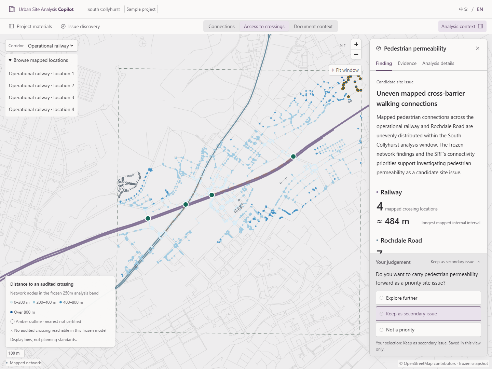
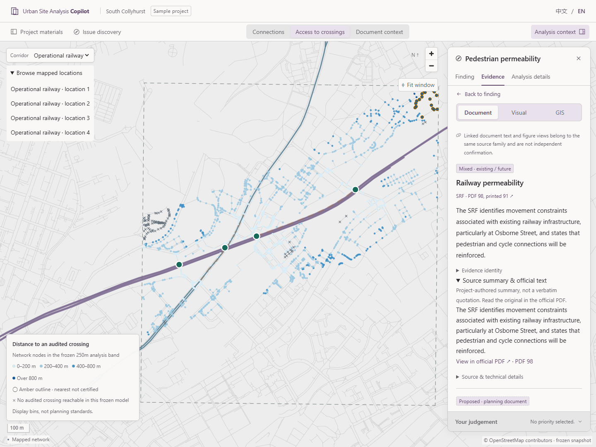
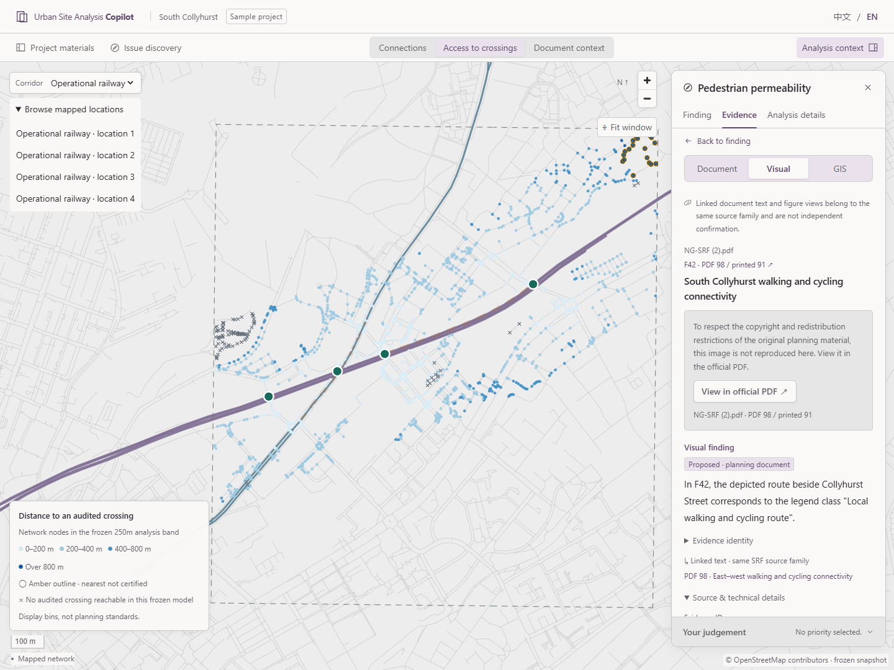

# 城市场地分析 Copilot 项目案例

产品案例 · Demo v1.0

**用可追溯的项目证据，帮助城市设计师发现并调查场地议题。**

Urban Site Analysis Copilot 将规划文档、图像证据与空间网络分析组织为一个地图工作台。当前以 Manchester 的 South Collyhurst 为唯一完整示例，围绕步行渗透性串起“资料入口 → 议题发现 → 空间调查 → 证据与发现 → 人工判断”。它提供有依据的调查起点，研究优先级仍由人决定。

**English introduction**

Urban Site Analysis Copilot is an evidence-led workspace for early-stage urban design investigation. The South Collyhurst prototype connects reviewed document and visual evidence with frozen pedestrian-network findings. Visitors inspect sources and spatial context, then decide whether to pursue the issue. The live demo presents precomputed results; it does not analyse arbitrary uploads or run AI/GIS inference in the browser.

- [公开 Demo](https://yilan-demo.orbit8907.com/)
- [Cloudflare 备用入口](https://urban-site-analysis-copilot-demo.pages.dev/)
- 项目重点：复杂资料的信息组织、AI 输出边界、地图与上下文交互、人机判断分工，以及从实验到可用原型的实现。

## 1. 产品背景与问题定义

这个项目源于我对建筑与城市设计前期研究过程的观察：设计师需要在规划文件、场地资料与空间数据之间不断切换，逐步形成对场地的认识。信息整理之外，研究者还需要判断应该调查什么、哪些资料能够支持判断，以及不同证据之间是否存在真实关联。这些工作高度依赖个人经验，面对陌生场地时尤其明显。

因此，我开始探索：**能否借助 AI，将分散的规划文本、图像信息与空间数据组织为一个可追溯、可交互的分析过程，帮助设计师发现潜在议题、核查依据并继续开展空间调查，而不直接替设计师作出结论？**

我以 South Collyhurst 为实际示例场地，结合文档检索、SRF 规划图件理解与 GIS 空间分析，构建 Urban Site Analysis Copilot。South Collyhurst 为产品提供了可以落实和检验流程的真实材料；产品动机来自更广泛的前期研究需求，并非将一次小组调研直接扩展为 AI 产品。

本项目希望降低资料整理与证据核查的复杂度，让设计师将更多精力投入分析、判断与设计决策。这仍是待进一步验证的产品目标。目前没有用户访谈、任务耗时对照或商业应用数据，不能据此声称已经验证需求或实现效率提升。

目标用户是开展前期场地研究的城市设计师或相关学生。问题定义基于我的工作观察与原型迭代，尚未通过系统用户研究验证。[E2、E16]

| 工作中的问题 | 本项目的回应 |
| --- | --- |
| 结论出现得太早，资料到议题的过程不可见 | 展示三条带来源和时态的线索，再进入候选议题 |
| 阅读文档与看地图时丢失空间上下文 | 地图持续保留，解释在侧栏切换 |
| 未来规划容易被误读为已有设施 | 在证据条目中显式显示现状、规划或不确定身份 |
| 多条命中看起来像多份独立支持 | 保留同源关系，明确图文不是独立双重验证 |
| AI 建议容易被当作最终决策 | 人工判断默认未选，不自动生成规划策略 |

### 示例资料的用途与来源边界

| 资料 | 在项目中的用途 | 归属与边界 |
| --- | --- | --- |
| 小组现场文字记录 | 小组成员在 Miro 中围绕道路停车、绿化、住宅建筑等写下的简短个人观察；在工作台资料中占比较小，作为文字背景，早期离线主题发现也曾使用 | 各成员观察有较多重合，保留原作者署名；不因重复表达而视为多份独立验证 |
| 小组现场照片 | 小组成员上传到 Miro 的原始场地研究资料 | 未用于 Demo 的多模态图像分析 |
| SRF 规划文本与图件 | 文本用于离线检索和文档证据；规划图件是多模态分析的主要对象，用于结构化视觉提取、视觉增量审核及来源追溯 | 区分现状与规划意图；关联图文属于同源证据 |
| OSM 空间数据 | 构建和审计步行网络，形成跨越位置、间隔及到达距离等冻结 GIS 结果 | 保留 OSM 署名与方法限制，不视为现场完整验证 |

现场文字记录在整体资料中占比较小，在 v0.1 的早期主题发现阶段曾作为输入；这一阶段的使用不改变产品面向多源资料组织与空间调查的定位。[E1、E10、E16]

## 2. 我的工作范围与独立贡献

### 产品与实现职责

我主导了产品定义、范围控制、AI 工作流设计、信息架构与交互设计，并借助 AI 编程助手推进实验脚本、前端原型和部署实现。我的工作重点是将资料、候选议题、空间调查与证据核查组织成可操作的产品流程，并明确模型输出、证据身份与人工判断之间的边界。[E16]

在推进过程中，我提出范围约束、纠正实验问题、选择界面方向、审核结果并控制发布边界；AI 编程助手参与代码、脚本与验证的实现。RAG 实验、规划图件分析、GIS 审计和交互迭代各有记录，其工作范围与小组现场资料贡献分别说明。

| 工作范围 | 我的具体贡献 | 对应产物与边界 |
| --- | --- | --- |
| 产品定义 | 将范围收敛为一个场地、一个步行渗透性议题；明确不生成设计策略 | 产品需求、综合卡与 UI 规格；原型阶段的范围控制 |
| AI 评估设计 | 指出整段任务提示词污染初始检索；要求冻结查询、语料和标签，分开比较方法 | v0.1–v0.5 文档及 benchmark；不是本人训练基础模型 |
| 可信度设计 | 提出视觉增量、同源去重、审核状态、现状／规划区分 | 多模态冻结记录、综合 schema 和界面来源详情 |
| 信息架构与交互 | 将纵向报告页调整为“地图工作区＋可收起侧栏＋浮层入口” | 工作台迭代记录与交互验收；尚未开展用户可用性测试 |
| 视觉与展示 | 决定中文默认、集中式文案、中性底色与深灰紫、渐进披露和图片灯箱 | README、tokens、组件及阶段验收记录 |
| 发布边界 | 要求私有源码与私有资源桶、匿名访问；原规划图改官方来源卡片 | 发布指令、生产报告、来源卡片代码 |

### 原始场地资料的贡献归属

原始场地研究由小组成员共同参与。各成员在 Miro 中提交的个人观察保留原作者署名，不归为我个人独立完成的现场资料。该小组是场地研究资料的贡献者，不是 Urban Site Analysis Copilot 的产品开发团队。现场照片未用于 Demo 的多模态分析，多模态输入主要来自 SRF 规划图件。[E1、E16]

## 3. 已实现的功能与信息架构

### 完整体验路径

```text
资料导入（Material Intake）
  └─ 自定义文件：仅展示文件名、类型、大小
  └─ South Collyhurst 示例：加载冻结资料与结果
       ↓
议题发现（Issue Discovery）
  铁路渗透性／东西向连接／Rochdale Road 横向联系
       ↓
候选议题 → 空间调查（Spatial Investigation）
  持续地图＋左右上下文侧栏
       ↓
分析发现（Finding）／证据（Evidence）／分析详情（Analysis Details）
       ↓
人工判断（Human Judgement）
  继续深入／保留为次要议题／暂不优先
```

这是一条已冻结示例的体验路径，不是网页实时生成候选的流程。[E3、E4]

### 地图与上下文的分工

| 区域 | 核心内容 | 已实现交互 |
| --- | --- | --- |
| 初始浮层 | 资料入口、原型边界、示例项目按钮 | 选择／拖放文件元信息，真实示例加载可取消和重试 |
| 左侧抽屉 | 项目资料、三条证据线索、候选议题 | 查看来源、进入空间调查、折叠后重新打开 |
| 中央地图 | 冻结路网、铁路、Rochdale Road、跨越位置与到达距离 | 缩放、平移、选择要素、切换三种模式 |
| 右侧面板 | 当前发现、证据、方法、要素详情 | 多级返回、技术详情、保留地图状态 |
| 议题页脚 | 人工研究优先级 | 默认未选；只保留当前页面状态，刷新后不持久化 |

地图模式为“跨越连接”“到达跨越位置”“文档背景”。前两者展示空间调查数据；文档背景打开图像证据上下文，不把图片配准成 GIS 规划路线。Evidence 中 Document／Visual／GIS 使用粘性分段导航，切换类别回到对应阅读起点。[E3、E4、E5]

## 4. 关键设计决策及依据

以下决策对应项目的需求约束与开发迭代记录。

### 从报告页改为持续地图工作台

历史版本采用纵向章节，阅读资料、地图与结论时容易失去连续的空间参照。我将其调整为可收起侧栏与浮层／画布结构：地图成为持续工作区，证据、发现和判断围绕当前议题展开。侧栏各自滚动，切换上下文不重置地图视角与选择。[E2、E3]

### 把资料入口放在同一个工作台里

先让使用者理解“议题来自项目材料”，再进入空间调查。上传入口只展示元信息，完整体验由明确标识的示例项目提供；加载说明指向已经完成的冻结流程，不制造实时 AI 工作的假象。[E3、E4]

### 主界面简洁，技术依据可追溯

主发现只保留摘要、铁路与道路两组核心数字、置信度和简短说明。分位数、条件性结果、方法与局限进入分析详情。来源默认使用可读标题和页码，证据 ID、source lineage 与 JSON 在二级技术详情中展开。后续 Evidence 修订增强分段导航与视觉结果的可发现性。[E2、E5]

### 视觉增量与同源披露共同设计

多模态记录区分 text-only、visual_added_value、retrieval_eligible 和审核状态。文字已有的事实不生成视觉替身；不确定拓扑不进入检索。界面仍可展示图像带来的图例／位置对应，但明确它与关联正文属于同一来源。[E6]

### 不把模型结论升级成用户决定

“中”等置信度是定性判断，不是模型概率、场地问题严重程度或优先级分数。人工判断三个选项等权、无默认选择，选中不启动新分析。界面支持诊断和调查，不输出最终规划策略。[E2、E4、E7]

### 用空间连续性约束动效

浮层退出、侧栏沿对应边缘收起，帮助理解状态变化；地图不因切换内容重新挂载。侧栏可反向打断，隐藏内容 inert；Escape 逐层返回，灯箱关闭恢复焦点。reduced motion 减少位移。记录明确区分 Emil 的界面打磨参考与 Apple 的交互原则，未采用 Apple 品牌视觉。[E3]

### 公开版本用官方来源卡片替代受限原图

本地历史版本可查看原始规划图；公网版保留已审核视觉分析、页码、时态和来源关系，通过按钮打开官方 PDF。不托管 F40／F42／F47 原图、缩略图或完整 SRF PDF。规划原图的阅读发生在官方来源，技术分析图仍可在工作台内通过灯箱查看。[E5、E8]

## 5. AI-native 与 Vibe Coding 工作流

本项目体现的 AI-native 能力是把证据身份、模型限制、审核与人的选择纳入产品流程；AI 协作开发则用于把这些约束落到可操作原型。二者不等于网页里有一个实时聊天机器人。

| 阶段 | 人的控制点 | AI／工具协作产物 | 验证方式 |
| --- | --- | --- | --- |
| 现场文字背景整理 | 保留各作者观察原文，无法拆分不猜测 | CSV 清洗脚本、JSONL、清洗报告 | 原文及作者来源保留，解析状态可检查；不是现场照片分析 |
| 早期候选发现 | 纠正 broad-query，在 v0.1 中先读取全部 23 条现场文字记录，再结合 SRF 检索 | 主题、查询、候选形成与调试记录 | 具体记录 ID 可追溯；仅描述该实验阶段，后续实验冻结候选 |
| 检索实验 | 固定查询／语料，逐项改变实验变量 | BM25、向量、RRF、精排及拆查询对照 | 完整排名、分数、模型 revision／hash、盲审包 |
| SRF 规划图件分析 | 定义 schema、视觉增量、审核及排除规则 | 规划图件分图提取、audit、英文检索视图 | 19 条获批视觉证据冻结；保留源关联，不使用小组现场照片 |
| GIS 与 QA | 对拓扑依赖提出诊断任务，不允许自动补线 | 路网、到达范围、站点 QA、渗透性审计 | 原始快照、OSM tags、节点／路径 ID 与局限 |
| 综合与交互 | 指定输入、审阅综合卡、选择工作台方向 | 固定证据综合卡、React 原型和测试 | 不调用外部 LLM 的确定性综合；界面回归与来源哈希 |
| 发布 | 逐项审核资源与预览，再批准生产 | 独立部署包、私有 R2、只读 Worker | allowlist、SHA-256、路由测试、生产验收记录 |

一个具体纠偏案例是 Queens Road 站点接入：冻结结果高度依赖一个 seed，但后续 QA 结论为 `mixed_or_ambiguous`，不能把不同图分量直接写成现实中分离的步行区域，也没有据几何接近补造连接。它说明本项目保留了“解释不了就继续核查”的路径。[E9]

另一个案例是查询拆分：停车／步道复合查询中的 `SRF_P056_C02` 原 Hybrid 第 7、精排第 26；改用固定的步道冲突子查询后为 Hybrid 第 2、精排第 7。它重新进入精排 top10，但精排仍比 Hybrid 排得低。垃圾／废物子查询也有相关段落被找回后仍遭降位，因此不能简单归结为“拆查询解决了模型问题”。这是有完整排名记录的诊断结果，不是对同一实验反复调参到成功。[E10]

上述工作保留了脚本、输入输出与审核记录。AI 协作带来的工时收益尚未测量；图像提取属于离线工作流，尚未建设可批量自动调用的线上 Vision 服务。

## 6. 技术选型、实验结果与边界

### 运行时与离线层分开

| 层级 | 实际实现 | 选择与边界 |
| --- | --- | --- |
| 网页 | React 19.2、TypeScript、Vite、MapLibre GL、Motion | 公开部署源码锁定 MapLibre 6.4.1；不是原本地 v1.0 的所有依赖都随之改变 |
| 数据交付 | Cloudflare Pages＋私有 R2＋同源只读 `/frozen/<source_id>` | 清单白名单、SHA-256、gzip；不是浏览器直连公开桶 |
| 文本检索 | Python BM25；BGE small 英文向量；NumPy 余弦；RRF | 319 条可返回 SRF chunks，无向量数据库；离线完成 |
| 精排实验 | MiniLM cross-encoder 官方 ONNX | 仅 query＋chunk text；top30 内重排，不直接加总不同分数；未用于多模态评估和网页推理 |
| 多模态 | SRF 规划图件的结构化提取、视觉增量筛选、人工审核与来源关联 | 冻结 19 条获批视觉证据，当前问题卡引用其中 5 条；未分析小组现场照片 |
| GIS | OSM 步行网络、图路径及跨越／间隔／到达距离审计 | 展示冻结 GeoJSON；不现场路由，不计算安全、舒适度或人流 |
| 综合 | 指定冻结证据与 GIS 指标的确定性编写 | 人工审核后展示，不是 Hybrid 自动生成的新结论 |

检索配置可追溯：BM25 `k1=1.5, b=0.75`；BGE 为 `BAAI/bge-small-en-v1.5`，revision `5c38ec7c405ec4b44b94cc5a9bb96e735b38267a`；384 维 CLS pooling、L2 归一化、无查询前缀。RRF 等权、`k=60`、每方法 top50，仅融合**同一查询**的两个排名。精排模型为 `cross-encoder/ms-marco-MiniLM-L6-v2`，revision `233902d25c440f23af6f7d6e94d2946bac0bee0a`。[E10]

注意“319”是可返回文本候选数；BM25 冻结统计背景为 319 条 SRF＋23 条现场记录，共 342 单元。多模态实验的可返回候选扩至 338，统计背景相应为 361。这不能简写成所有阶段都只用 319 条计算 IDF。[E10、E12]

### 可报告的评估结果

**冻结 11-query benchmark**：同一语料、同一查询、三方法 top10 union 的同一组回传 D/C/I 标签。以下为 11 题宏平均；D 为直接相关，C 为有用背景。[E11]

| 方法 | 直接证据 Precision@10 | 有用证据率@10（D＋C） | nDCG@10 |
| --- | ---: | ---: | ---: |
| BM25 | 23.64% | 90.00% | 0.8732 |
| Hybrid | 36.36% | 88.18% | 0.8649 |
| Hybrid＋Reranker | 28.18% | 82.73% | 0.7693 |

这支持“本组任务中 Hybrid 的直接证据比例高于 BM25，通用 reranker 没有稳定改善结果”的描述；不能宣布一种方法普遍最优。较高的背景证据率或 nDCG 不等于较高的直接证据比例。评审者人数、独立性与 prior exposure 未经独立核实；这是小规模开发资料评估，无统计显著性主张，pool 也不是全语料真值。

早期 v0.2 的三方法直接相关计数为 27／60、30／60、36／60，来自**模型辅助标签**，与上述 11 题回传标签不是同一次实验。不得混用或称为独立准确率。[E10、E13]

**多模态评估**：10 条预先指定 query／gold 的已知证据探针，Visual Recall@5 为 30%，Recall@10 为 80%，MRR 为 0.155489；不是一般检索准确率。文字回归中 Text-only 与 Text＋Visual 的直接证据率均为 36.36%，有用证据率均为 88.18%，共享 IDCG 下 nDCG 从 0.864880128794 到 0.864907967181。差值极小，不能声称普遍提升。新增视觉命中仍须按同源规则解释。[E12]

### 空间结果如何呈现

主要运营铁路 MVM 的 7 条确认网络路径聚为 4 个跨越位置，最长内部已映射间隔约 484m；Rochdale Road 为 7 个位置、约 353.3m。跨越路径数与位置数不能互换，间隔也不是到达跨越位置的最短路距离。[E14]

MVM near-barrier finite pool 的到达距离中位数为 272.5m，P90 为 424.4m，其中 21 条结果带 context 条件性；主卡只显示核心位置数和间隔，详细分布留在证据／方法中。Metrolink 最长区间大部分覆盖源数据中的 tunnel，不解读为连续地表铁路阻隔。以上不能证明某处“不安全”“不可达”或必须增设跨越，也没有使用间隔阈值作优劣评定。[E14]

### 当前局限

- 网页仅完整支持一个冻结示例，不支持任意项目自动分析、实时 RAG／Vision／GIS、自由问答或自动设计策略。
- 自定义资料不读取正文、不上传、不进入索引；Human Judgement 只存页面内存，不是项目管理或多用户协作系统。
- 文档背景未地理配准，未来路线不叠入现有网络；源文档日期和 OSM 快照不能代表实时场地状态。
- OSM 拓扑没有经过现场完整验证，不衡量安全、舒适、照明、路面质量、临时封闭或实际人流。
- 大路网和 MapLibre bundle 存在首次加载成本；没有可核实的跨设备性能或真实访客转化数据。

## 7. Demo 与界面展示

正式生产发布阶段记录了 3／3 线上 Playwright、39／39 路由测试和资源校验通过；本地 v1.0 的 14／14 属于此前的独立验收。上述测试来自各自阶段，分别记录。[E8、E15]

### 公网版截图

以下截图来自生产版本验收，展示真实冻结数据与界面状态。



到达跨越位置模式展示冻结网络距离点及当前发现。图中“保留为次要议题”是当次验收中**人工点选后的状态**，系统默认不选择优先级。



文档证据显示摘要与页码，原文通过官方 PDF 阅读。



视觉结果、proposed 身份、关联文字与来源详情入口保留；源规划图通过官方 PDF 查看。截图展示来源技术详情展开的上部。

### 体验路径

从资料入口加载示例，查看证据线索与候选议题，再进入到达跨越位置模式；选择地图要素，阅读发现及文档／视觉／GIS 证据，展开方法与技术图，最后回到人工判断。完整流程均可通过 Demo 内的正常交互到达。

## 8. 资料与技术记录

项目保留以下研究与开发记录。表中路径是研发记录的标识，用于说明论述依据，并非本展示包内的文件链接；展示包仅收录案例文档与界面截图，不包含这些研发文件或冻结数据。

| 编号 | 来源 | 支持的内容 |
| --- | --- | --- |
| E1 | `README.md`、`cleaning_report.md`、`site_survey_clean.jsonl` | 五份现场 CSV 的清洗与来源保留；不证明用户研究结论 |
| E2 | `spatial_analysis_ui_v1/spatial_analysis_ui_spec.md`；布局评审与冻结要求 | 初始设计约束、证据分层、人的判断权；后续布局以 E3 为准 |
| E3 | `demo_frontend_v1/README.md`、`demo_frontend_v1/artifacts/workspace-prototype/workspace-review.md` | 地图工作区与浮层布局、连续性、动效、入口边界及历史验收 |
| E4 | `cloudflare_pages_production_v1/source/src/App.tsx`、`MaterialIntake.tsx`、`data.ts` | 状态、三种模式、元信息导入、冻结加载、非持久化判断 |
| E5 | 同目录 `src/ContextPanels.tsx`、`EvidenceContent.tsx`、`evidence-revision.css` | 三类证据、sticky 导航、官方 PDF、摘要与来源卡片 |
| E6 | `rag_multimodal_v1/multimodal_v1_freeze_report.md`、各图 v1.1 extraction／audit | 视觉增量规则、人工审核、19 条批准记录与同源关系 |
| E7 | `analysis_synthesis_v1/synthesis_manifest.json`、综合卡及 schema | 指定证据综合、未调用外部模型、定性置信度与判断边界 |
| E8 | `cloudflare_pages_production_v1/production-release-report.md`、生产源码 `THIRD_PARTY_NOTICES.md` | 已发布状态、资源隔离、线上验收、公开资料边界 |
| E9 | `gis_v02_station_access_qa/gis_v02_qa_summary.md` | Queens Road seed 依赖与混合／不确定 QA 结论 |
| E10 | `README_V01.md`–`README_V05.md`、模型及实验 manifests | 候选与实验演进、检索参数、模型锁定和早期标签身份 |
| E11 | `rag_final_benchmark_v1/final_benchmark_interview_summary.md` | 11 题宏平均与评估局限 |
| E12 | `rag_multimodal_retrieval_eval_v1/multimodal_retrieval_v1_summary.md` | 能力探针、文字回归、共享 IDCG 与统计背景 |
| E13 | `prd_technical_review_v1/PRD_Technical_Accuracy_Review_v1.0.md` | F01–F06 技术口径修正 |
| E14 | `gis_v1_south_collyhurst_permeability/gis_v1_audit.md` | 路径／位置计数、间隔、到达距离及 tunnel／context 局限 |
| E15 | `demo_frontend_v1/release_v1.0/FINALIZATION_REPORT.md` | 本地冻结验收，与后续公开部署分开 |
| E16 | 项目定义与资料来源说明 | 产品动机、本人职责、小组资料贡献边界、现场照片未用于多模态分析；属于项目背景说明，不是用户调研或效率测试数据 |
