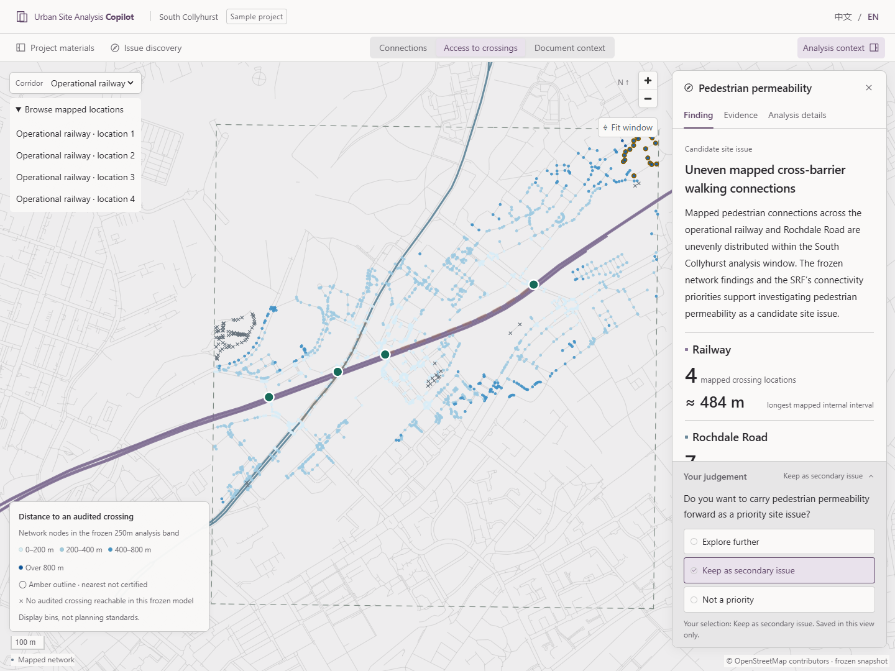
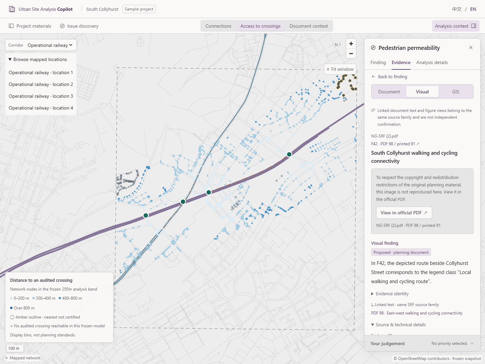

# 城市场地分析 Copilot

**从项目材料出发，在地图上调查议题，让判断回到人。**

面向城市设计前期研究的 AI 辅助分析工作台。当前以 South Collyhurst 的步行渗透性为完整示例，串起资料入口、证据线索、空间调查、来源追溯与人工判断。

**[体验在线 Demo](https://yilan-demo.orbit8907.com/) · [备用入口](https://urban-site-analysis-copilot-demo.pages.dev/) · [阅读项目案例](PROJECT_CASE_STUDY.md)**

Urban Site Analysis Copilot is an evidence-led workspace for early-stage urban design investigation. This prototype connects reviewed document and visual evidence with frozen pedestrian-network findings, keeping sources traceable and the final research priority in human hands.

*历史生产验收画面：地图展示冻结网络结果；右下方为验收时人工选择后的状态，系统默认不选优先级。*

## 这个项目解决什么

在建筑与城市设计的前期研究中，设计师需要查阅规划文件、整理多源数据，并结合现场调研与空间分析形成判断。面对陌生场地，研究者还需要自行确定分析方向、筛选资料，反复核对证据之间的关系。

基于这一工作中的观察，我设计并开发了 Urban Site Analysis Copilot，探索如何借助 AI 将分散的文本、规划图件与空间数据组织为可追溯、可交互的分析过程，帮助设计师发现值得进一步调查的议题，同时保留最终判断权。

产品以曼彻斯特 South Collyhurst 为实际示例，串起“资料整理 → 议题发现 → 空间调查 → 证据核查 → 人工判断”。当前公开 Demo 展示已审核的冻结成果，不执行任意资料的实时分析。降低前期信息整理与证据核查的复杂度是产品目标，尚无效率提升的测量结果。

它的重点是一个可以操作的分析过程：**资料导入 → 议题发现 → 空间调查 → 证据与发现 → 人工判断**。完整案例解释了问题定义、设计取舍、AI 协作过程和评估边界。

## 资料从哪里来

- **现场文字记录**：小组成员在 Miro 中提交的简短个人观察，作为少量背景资料，并曾用于早期离线主题发现；保留各作者署名。
- **SRF 文本与规划图件**：分别用于文档检索和多模态图像分析。小组拍摄的现场照片未用于 Demo 的多模态分析。
- **OSM 空间数据**：用于步行网络与跨越位置、间隔、到达距离等 GIS 审计，网页展示其冻结结果。

South Collyhurst 是产品的实际示例场地；原始场地研究小组是资料贡献者，不是 AI 产品开发团队。

## 两分钟体验

1. 打开 Demo，选择“使用 South Collyhurst 示例项目”。右上角可切换中文／EN。
2. 在左侧查看铁路渗透性、东西向连接和 Rochdale Road 三条线索，进入空间调查。
3. 切换“到达跨越位置”，查看网络距离点与右侧发现；点击地图要素查看上下文。
4. 打开证据，在 Document／Visual／GIS 之间切换，展开来源技术详情；原规划材料通过官方 PDF 阅读。
5. 查看分析详情与技术分析图灯箱，最后自行选择是否继续研究该议题。

## 设计与实现亮点

- **持续地图工作台**：浮层入口、可收起左右侧栏、与地图选择对应的上下文；查看证据时保留空间参照。
- **可追溯的 AI 结果**：文档摘要、视觉增量和 GIS 结果分开呈现，保留页码、时态、ID 与来源关联。
- **渐进披露**：主卡只显示核心发现、置信度和一条说明；分位数、方法、局限和 JSON 放入可展开详情。
- **克制且可逆的交互**：多级返回、Escape、焦点恢复、reduced motion；人工判断不预选。
- **从实验到上线**：离线对照检索方法、冻结语料与标签，再将审核成果接入公开 HTTPS Demo。

## 当前能力与边界

| 现在可以体验 | 当前不提供 |
| --- | --- |
| 一个真实 South Collyhurst 冻结示例 | 任意项目自动分析、实时 AI 或 GIS 计算 |
| 自定义文件名、类型、大小的本地展示 | 文件正文读取、上传、自动建库 |
| 三种地图模式与地图要素选择 | 地图路线规划、规划图地理配准 |
| 文档／视觉／GIS 证据、来源详情与官方 PDF | 公网托管受限原始规划图、缩略图和完整 PDF |
| 当前页面内的人工判断 | 登录、多用户协作、刷新后的判断持久化 |

规划中的 proposed 内容不表示已建成；同源图文不算两份独立佐证。OSM 模型不证明现场通行、安全或舒适度，间隔数字不作为规划标准评判。

## 技术与评估

网页使用 React、TypeScript、Vite、MapLibre GL 和 Motion；Cloudflare Pages 提供前端，私有 R2 经同源只读白名单路由提供资源。浏览器只加载冻结结果，没有在线模型调用。

离线研究包括：BM25、`BAAI/bge-small-en-v1.5`、RRF 融合、MiniLM cross-encoder 精排诊断，以及视觉证据增量与 OSM 网络审计。RRF 只融合同一查询的排名，精排实验未成为在线功能。

冻结 11 题评估中，BM25／Hybrid／Hybrid＋Reranker 的直接证据 Precision@10 分别为 **23.64%／36.36%／28.18%**。这是同一组回传标签上的开发集描述性比较，不能称为总体准确率或独立专家验证，也不证明复杂方法必然更好。评估方法、其他指标、视觉探针和局限见[完整案例](PROJECT_CASE_STUDY.md#6-技术选型实验结果与边界)。

## 我的角色与 AI 协作

我主导了产品定义、范围控制、AI 工作流设计、信息架构与交互设计，并借助 AI 编程助手推进实验脚本、前端原型和部署实现。工作重点是将资料、候选议题、空间调查与证据核查组织成可操作的产品流程，明确模型输出、证据身份与人工判断之间的边界。

小组成员的原始现场观察保留各自署名，不归为我个人独立完成的资料；原始场地研究小组不作为产品开发团队。代码、脚本与验证通过 AI 编程协作推进，具体工作范围见案例第 2 节。

## 如何查看

本展示包包含项目说明、完整案例与三张界面截图，解压后可使用支持 Markdown 的阅读器查看；放入 GitHub 项目文件夹后，图片和案例链接按相对路径显示。

完整交互请访问上方公开 Demo，无需登录或安装本地环境。展示包不包含应用源码、分析数据、依赖或部署凭据，不能作为本地应用启动包。技术实现与运行边界见完整案例第 6 节。

## 技术实现结构

以下为应用的实现结构，用于说明功能分工；源码不随本展示包分发。

| 路径 | 作用 |
| --- | --- |
| `src/App.tsx` | 地图工作区、上下文历史、议题与判断状态 |
| `src/MaterialIntake.tsx` | 元信息文件入口与示例加载 |
| `src/AnalysisMap.tsx` | 冻结 GIS 图层与要素交互 |
| `src/ContextPanels.tsx`、`src/EvidenceContent.tsx` | 发现、证据、方法和来源卡片 |
| `src/TechnicalImageViewer.tsx` | 技术分析图灯箱 |
| `src/i18n.tsx`、`src/workspace-copy.ts` | 集中式中英文文案 |
| `src/theme.css` | 中性基底、深灰紫 UI；GIS 语义色分开管理 |
| `manifests/`、`scripts/`、`tests/` | 资源清单、构建／核验工具、自动化验收 |

## 截图与资料说明

*公网版保留视觉增量及来源关系，原图通过官方 PDF 查看。截图来自生产版本验收。*

正式生产发布阶段的验收记录为：线上 Playwright 3／3、路由测试 39／39 通过。

地图资料署名：© OpenStreetMap contributors，ODbL 1.0。规划材料保留原版权，通过[官方 SRF PDF](https://www.northerngatewaymanchester.co.uk/wp-content/uploads/2018/07/NG-SRF.pdf)查看。原始数据说明见 [OpenStreetMap 版权与许可](https://www.openstreetmap.org/copyright)。公开 Demo 供在线体验，本文不授予项目源码或第三方材料的再分发许可。
