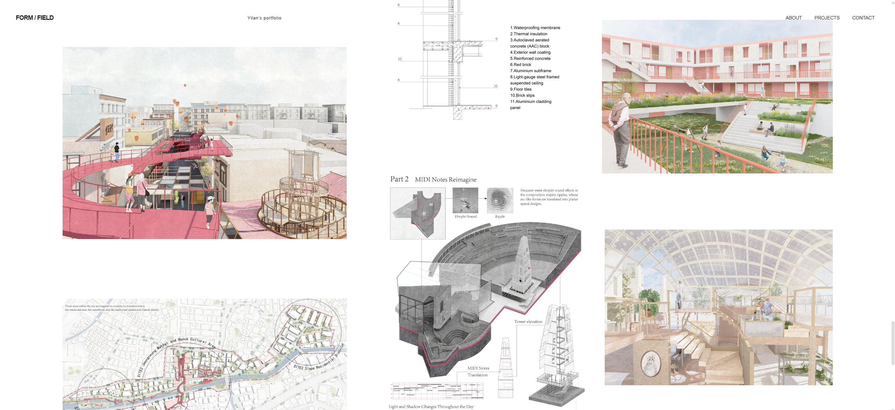
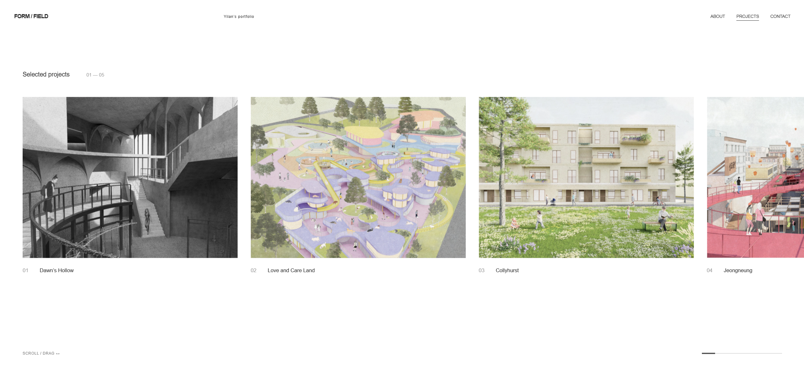
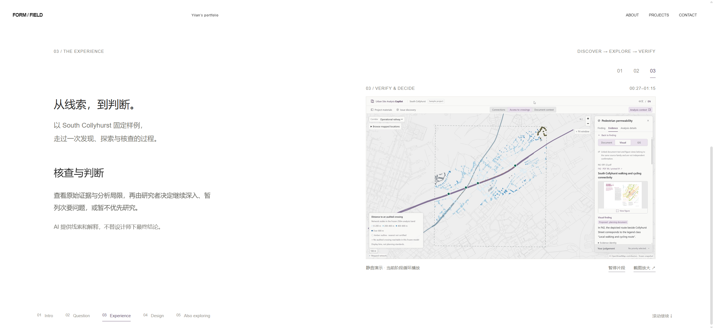

# Interactive Portfolio — Architecture × AI × Creative Coding

> 招聘展示文档草稿｜面向 AI 产品设计师岗位｜2026-11-17
>
> 本案例讲述个人作品集网站的视觉、交互与实现过程。Urban Site Analysis Copilot 是网站中展示的另一项实践；其检索评估、GIS 分析或模型能力不属于本网站的技术成果。

**English overview** — A personal portfolio that brings architectural work and AI experiments into one editorial browsing experience. The project explores how motion, spatial composition and detailed reading can coexist, with AI-assisted coding turning design direction and iterative feedback into a working website.

## 阅读依据

本文区分三类信息：

- **实现事实**：当前代码、静态资产或路由中可核对的行为。
- **历史支持**：Git 提交、仓库设计说明或已有实录支持的迭代。对设计意图的解释基于这些记录，不等同于用户测试结论。
- **待作者确认**：初始动机、具体分工、素材权利和未经记录证明的个人经历，不作为已证实成果。

本案例整理时核对了原网站项目 `c6fd71f` 及其可访问历史、设计说明与既有展示检查记录，并比对了正式首页与本地 HTML；未重跑全站交互测试。初始 Git 提交已包含成熟建筑网站，无法逐次还原此前所有构思过程。其他独立原型不计入本网站的交付能力。本文件夹仅收录案例文档、作者指定截图和5秒交互 GIF，不包含原代码仓库或内部检查资料。

## 1. Project Overview & Creative Concept

### 一个作品集，多种浏览节奏

网站围绕一句自我介绍展开：**“Spaces, stories, and a few small obsessions.”**

建筑作品需要远看构图，也需要近看图纸；数字产品需要展示界面如何随操作变化。网站没有把所有内容压入同一种项目卡片，而是采用三种互补的呈现方式：

| 浏览方式 | 已实现的载体 | 在本案例中的设计意图解释 |
| --- | --- | --- |
| 先被作品吸引 | Jelly / 曲面封面与开场 | 以图像和运动建立第一印象 |
| 快速选择与比较 | Architecture 横向索引、双栏导航 | 提供可直接进入的作品入口 |
| 深入阅读 | Gallery、A3 Viewer、AI Case Study | 让不同类型内容按合适的节奏展开 |

这是一组设计取舍，并无已完成的转化率、停留时长或商业增长验证。

### 建筑与 AI 的内容关系

建筑项目顺序来自 `dist/js/projects.js`：Dawn’s Hollow、Love and Care Land、Collyhurst、Jeongneung、AgroNest，共 5 个项目、37 张展板。Gallery 收录其中 14 张图像，既有渲染，也有图纸、空间研究和模型照片。

AI & Digital 通过同一导航进入 Copilot Case Study，使用真实录屏、证据图和说明展示另一个项目。它与 Architecture 共享视觉语言，而非新增第六个建筑封面。最后一张封面和横向索引末尾均有轻量文字入口，使浏览建筑与探索数字实践之间形成可选路径。

**待确认**：最初为何选择“纸张 / 曲面 / Jelly”作为隐喻、是否有被放弃的方向，以及本次求职中最希望观众记住的个人标签。

## 2. Visual Identity & Design Language

### 留白承接内容，运动提供结构

- **白色背景与低对比注释**：让项目图像成为视觉主体；灰色编号、小字与细下划线承担导航和补充信息。
- **字体有角色差异**：基础导航为 Arial / Helvetica 等系统无衬线；首页陈述使用 Georgia / Times 类衬线；中文采用平台字体回退。网站不是全站统一衬线，也未建立独立的品牌字体资产。
- **远看封面，近看展板**：首页曲面阶段呈现方形裁切；横向索引展开为 4:3 封面；详情页按图像实际比例适配，以 A3 横向阅读为初始框架。
- **Gallery 是人为构图**：图像尺度、位置和留白由布局数据控制，而非自动瀑布流。图像保持比例，caption 补充项目与图像类型。
- **数字内容延续同一气质**：Copilot 页以克制的紫色操作强调、真实 UI 和较大的图像为主，没有另建深色科技风格站点。



### 素材与 AI 的边界

| 内容 | 当前可确认的来源与用途 | 不作出的声明 |
| --- | --- | --- |
| 建筑封面、展板、模型照片 | 作者在开发中提供的项目文件，经网页格式与尺寸处理后展示 | 不据此断言每张图都是个人独立原创，或完全未使用 AIGC |
| Puffy 照片 | 作者提供的真实照片，转为 WebP 并按需加载 | 不是生成的宠物照片 |
| Copilot 界面、视频 | 作者提供的实际产品录屏和截图；来源清单见媒体 manifest | 不是生成的虚构 UI，也不是网站内重建的 GIS 工具 |
| 规划 / GIS 证据图 | Copilot 样例相关来源资料；保留上下文与限制 | 不统一归属为作者原创研究图 |
| 网页布局与交互代码 | 通过设计要求、参考、预览反馈与 Codex 辅助实现 | 不描述为本人逐行手写 |
| 本文展示图片 | 作者提供的「首页2」「index」「gallery」「ai demo」「首页」PNG，原样复制；另从原演示前5秒制作交互 GIF | 不恢复助手静态抽帧，不生成虚构 UI；GIF 不是实时性能测试 |

**待确认**：建筑项目各自的个人 / 小组贡献、第三方图片与资料的公开许可、素材内部的 AI 生成或后期处理范围。

## 3. Interaction & Motion Design

### 首页：让图像成为可展开的表面

**实现事实**：Three.js 创建五张细分平面，通过自定义顶点着色器沿曲面和释放路径弯曲；滚动位置映射为旋转目标，弹簧状态跟随输入，并以轻微形变传达运动。开场包含落下、堆叠、展开到曲面的过程，提供 Skip / Replay 和 Color / White Grid 控制。

这里的 Jelly 是自定义几何与动画表现，不是经验证的软体物理仿真。代码来源：`scene.js`、`paper.js`、`belt.js`、`cylinder.js`。

**实际路径需要区分**：

- 点击可见 Jelly 封面：直接打开对应项目详情。
- 在首页选择 PROJECTS → Architecture：捕获当前几何状态，经过 Stack 重组，再展开为横向 Index。
- 向下浏览完五张封面：继续进入 Gallery，而非自动进入 Index。
- 从 About / AI Case Study 选择 Architecture：直接进入完成态 Index，不强制重播首页。

因此不能将网站描述为“点击任意封面都先播放 Stack”。Stack 通过复用同一组纸面对象连接两种构图，不靠新增一套封面替换原画面。

### Gallery：从运动表面到图像档案

**实现事实**：当最后一张封面退出，Gallery 通过位移进入画面；进入完成后交给正常文档滚动。向上可返回展示，图像可进入对应项目详情。独立布局编辑器支持拖移、四角等比缩放、数值调整、对齐、撤销 / 重做、JSON 导入导出。

一个重要交付细节是：**本地编辑不等于全站发布**。编辑覆盖存于当前浏览器 `localStorage`；正式默认布局在 `gallery-published-layout.js`。发布脚本将导出 JSON 转为所有访客可用的布局。桌面与手机分别保存配置。

这让作者能够继续调整构图，但当前编辑器不是带账号、权限或多人协作的后台。

### Architecture Index：选择项目与保留返回位置

**实现事实**：横向索引支持滚轮、指针拖动、方向键与位置滑杆；索引内封面链接提供键盘入口。打开详情会保存来路状态，关闭后恢复浏览位置和焦点。末尾 Digital Experiments 是未编号的文字附录，不算第六个建筑项目。



### A3 Viewer：把“浏览”与“检查细节”分开

**实现事实**：项目详情支持翻页箭头、键盘、水平拖拽 / 滑动与滚轮输入识别。点击展板进入放大查看；放大后支持拖移、滚轮缩放、双指缩放、FIT 和退出。放大使用同一张已解码图像，保持阅读连续性。图片失败时显示重试入口；等待资源时保留加载反馈。

**设计取舍**：默认保全整页以理解版面，查看细节由明确操作触发，而不是始终把图纸裁成满屏。存在这些输入实现，不代表已证明所有触控设备上的体验相同。

未提供独立 A3 截图，因此不添加配图；可通过正式网站体验展板放大过程。

### AI & Digital：展示工作流程

**实现事实**：Copilot Case Study 有 Intro、Question、Experience、Design、Also Exploring 五章。Intro 大图保持尺寸，原生下滑开始后从真实视频第 7 秒静音播放；完整视频按钮从头打开约 75 秒的录屏。Experience 随阅读切换 Discover / Explore / Verify 三段真实界面；Design 保留左侧说明，右侧切换证据和 GIS 图与视频小卡。PRD 和外部 Demo 提供进一步探索入口。

较大桌面采用场景转场与固定视觉窗口；窄屏、粗指针、矮窗口、减少动态效果和打印使用自然文档流。离开章节、隐藏标签页或打开另一播放器时暂停相关媒体。此站没有实现真实可操作的 GIS 地图、通用文件分析或模型推理后端。



### About 与轻量导航

**实现事实**：中文介绍按组揭示，标题、正文、学校与角落注脚有不同进入时序；Puffy 可点击展开小照片，外部点击或 Escape 关闭；从 About 的 FORM / FIELD 返回会重新播放首页开场。

PROJECTS 可 hover / focus / 点击展开双栏菜单，包含键盘方向键、Escape 与外部关闭。CONTACT 没有独立页面：鼠标或键盘显示邮箱；触屏首次点击展开，再次点击打开邮件应用。

### 响应式与可访问性的实际范围

代码包含手机间距与字号调整、独立 Gallery 手机布局、触屏指针处理、键盘入口、ARIA 状态、隐藏内容 `inert` 管理、焦点恢复，以及 `prefers-reduced-motion` 分支。首页 WebGL 2 不可用时有错误提示，尚不能据此称为完整无 WebGL 替代首页。

仓库记录包含浏览器与触屏模拟检查；真实手机 GPU、实体触控板惯性、屏幕阅读器全流程和跨浏览器一致性仍需专项验证。没有宣称无障碍认证或全设备稳定帧率。

## 4. Design-to-Code / Vibe Coding Workflow

### 从意图到可验证的行为

本项目可见的协作方式是：作者提供真实素材、布局参考和具体交互要求 → Codex 辅助拆分组件与实现 → 本地预览 / 截图 / 状态检查 → 作者以圈图、录屏和文字指出偏差 → 定点修改并复核 → Git / Vercel 交付。

“Vibe Coding”在这里不等同于一次提示生成成品。实际记录体现了反复定义触发条件、图片边界、进入与返回路径，以及分清视觉效果与资源状态。

### 有记录支持的迭代

| 问题与设计判断 | 实际修改 | 可核查记录 |
| --- | --- | --- |
| Gallery 在另一浏览器 / 线上不能自然继承本地排版 | 区分正式布局与本地覆盖，通过 JSON 发布默认构图 | `f98bce7`；`gallery-published-layout.js`、发布脚本 |
| 地图封面下滑后切成灰底上传窗口，视觉语义断裂 | 拆分静音预览与完整演示；后来采用新版录屏，从指定时间开始，不再缩小大图适配一屏 | `bf1bdea` → `427ea7e` → `0be8f7e`；demo notes |
| Experience 同时出现过多阶段、图文位置不符合参考 | 将阶段入口放在媒体上方，保持视觉窗口稳定，以本地阅读区依次揭示内容 | `1f567d8`；当前 Case Study HTML / 场景模块 |
| Design 静态长卡难以展示真实证据展开过程 | 使用专门重录的小卡视频，分别展示 Evidence 与 Analysis details，保留圆角并校准对齐 | `6b826e7`、`8437423`、`f902b72` |
| 建筑与 AI 内容需要分流，又不能打乱五个建筑项目 | 双栏导航、直接 Index 入口、索引末尾附录；最后封面另加文字注脚 | `84c83c5`、`1435bfb`、`b5a9a5f` |
| Demo 入口覆盖产品界面 | 将按钮移到视频上方、右侧对齐 | `72efb8f` |
| 自我介绍需要更贴近中文求职展示 | 中文 About、学校名称与简历入口；后续替换公开 PDF | `00eb299`、`c6fd71f` |

这些记录能支持“提出反馈并持续调整”的过程；不能单独证明每项创意的唯一提出者，或推导 AI 节省了多少工时。

### 检查也需要界定适用版本

`docs/copilot-motion-audit.md` 记录过输入识别、可中断转场、DOM 冗余更新、焦点与触屏模拟检查，并报告一轮 63 项浏览器检查。该文件含早期“大图展开为播放器”等已被后续修改的方案，应按时间阅读，不能把每项早期行为或测量当作当前版本保证。

本案例不将历史 CDP 计数、录屏播放的掉帧统计换算为真实性能提升百分比；没有正式用户测试、效率提升或招聘转化数据。

## 5. Technical Implementation

### 实际技术栈

| 层次 | 当前实现 |
| --- | --- |
| 页面与内容 | 原生 HTML、CSS、JavaScript ES Modules；项目元数据驱动展板与封面 |
| 曲面与转场 | 本地 vendored Three.js、WebGL、GLSL、requestAnimationFrame；角度弹簧与几何状态插值 |
| 常规交互 | DOM Pointer / Wheel / Keyboard Events、CSS transform / opacity、Web Animations API |
| 路由 | Architecture / About / 项目详情使用 History API 与静态 HTML 入口；AI Case Study 为独立静态路径 |
| 图像与媒体 | WebP 项目资产、实际 MP4、按需加载、decode、加载状态与回退图 |
| 本地布局数据 | localStorage、带校验的 JSON 导入导出、正式布局模块 |
| 构建与发布 | Node.js 入口生成脚本、GitHub 版本管理、Vercel 静态部署、自有域名 |

仓库没有 React、Next.js、GSAP、Framer Motion、登录服务或模型服务端。GitHub / Vercel 用于网站交付，不是 AI 训练或产品分析基础设施。

### 结构

```text
dist/                              # 实际维护的网页源文件与静态输出
  index.html / style.css           # 首页与共享页面结构
  js/
    app.js                         # 页面状态、输入和模块协调
    scene.js / paper.js / belt.js   # WebGL 纸面、着色器与运动路径
    reorganize.js                  # Stack 与 Index 构图转换
    horizontal-index.js            # 横向输入与位置状态
    gallery*.js                    # 图像档案、编辑与正式布局
    project-router.js              # 项目 / About / Index 路由
    project-viewer.js / board-*.js  # 展板阅读、资源加载与放大查看
    about.js / contact.js          # 介绍揭示、彩蛋和邮箱
    projects-navigation.js         # 双栏分类导航
  digital/urban-site-analysis-copilot/
    index.html / case-study.*      # AI 项目的展示页
    media/                         # 真实产品录屏、截图和证据图
  covers/ gallery/ projects/        # 建筑图像与展板
  documents/                       # 简历与 PRD PDF
  vendor/                          # 本地 Three.js 模块
scripts/
  prepare-detail.mjs               # 同步静态项目及 About 页面入口
  publish-gallery-layout.mjs       # 发布 JSON 默认构图
docs/                              # 设计、素材与检查记录
vercel.json                        # 静态输出与构建配置
```

`dist/` 并非由另一套 React 源码生成的产物；构建脚本会同步首页结构到详情 / About 的静态入口，因此维护共享页面时应编辑首页结构。保留的 6 张 SVG 是历史占位文件，当前五个项目实际引用 WebP 展板，不应作为已完成作品数量。

### 性能与完整性的取舍

- WebGL 像素比上限为 2，封面纹理异步加载；Three.js 随站点交付，首页不依赖外部库 CDN。
- Viewer 优先请求并解码前两张展板，后续按低优先级顺序加载；跳页所需资源可提升优先级，失败提供重试。
- Gallery 前部图片优先，其余声明延迟加载，保留尺寸与比例；**部分 Gallery 源图仍很大**，不能称为已完成全面压缩和弱网优化。
- AI 页视频使用延迟设置 source、poster 与解码首帧门控，避免预览错误从上传页开始；视频离开可见场景即暂停。
- 窄屏和减少动态效果时使用更直接的阅读结构，不强制在手机上缩小桌面整屏。

这些是具体处理，不构成“全站 60fps”“任何网络即开”或“所有资源均已最优”的承诺。

## 6. Live Experience & Visual Showcase

### 真实入口

- [网站首页 / Jelly](https://portfolio.orbit8907.com/)
- [Architecture Index](https://portfolio.orbit8907.com/?view=architecture)
- [Collyhurst A3 Viewer](https://portfolio.orbit8907.com/projects/collyhurst)
- [AI & Digital Case Study](https://portfolio.orbit8907.com/digital/urban-site-analysis-copilot/)
- [中文 About / Puffy](https://portfolio.orbit8907.com/about)

### 推荐展示图与镜头

| 重点 | 已整理的真实截图 | 更适合录制的动作 |
| --- | --- | --- |
| 曲面与图像 | [作者提供的首页2](assets/jelly.png) | 一张封面沿曲面进入、变形、退出 |
| 图像构图 | [作者提供的 Gallery](assets/gallery.png) | 从曲面滚入档案、查看图像与回到展示 |
| 项目选择 | [作者提供的 Index](assets/architecture-index.png) | PROJECTS 选择 Architecture，Stack 后横向拖动 |
| 细节阅读 | 本轮不配图 | 翻页后点击展板原生放大，再关闭返回 |
| 数字作品呈现 | [作者提供的 ai demo](assets/copilot-experience.png) | 同一视觉窗口依次出现 Discover / Explore / Verify |
| 个人性格与轻量反馈 | 建议补拍当前 About、Puffy 与导航截图 | 逐段进入 About、点击 Puffy、键盘打开分类菜单 |

静态配图全部来自作者指定文件，未裁切、转码或改变像素内容；旧抽帧配图已移除。「首页.png」保存在 `assets/walkthrough-cover.png`，现仅作普通静态图展示，不再链接完整视频；「首页2」继续用作 README 主视觉，其后展示 `assets/home-interaction.gif`，内容来自原视频前5秒。

### 已有演示视频

本地存在 `Yilan_Interactive_Portfolio_Meitu_Showcase_v2.mp4`，核实为 **108.77 秒 / 1920×1080 / 30fps / H.264 / 34.7 MB**，无音轨。作者已决定暂不在 GitHub 展示完整视频；不创建 Release / Tag，不上传 MP4，也不提交 MP4 到 Git 历史。原发布方案已取消。本地原文件保留不变。

原始视频仅作为本地制作记录保留，不随本展示包提供，也没有完整视频观看入口。

视频中的 Jelly 段相对前一版剪辑加速 1.5 倍；大地图定点播放停留约 12 秒；Experience 三段标题通过实际滚动对齐。**这是演示剪辑处理，不是对网站滚动算法或速度的修改。** 视频中的“返回封面→进入 Index”经过导航真实触发 Stack，未虚构封面点击可触发 Stack。

README 仅采用视频前5秒的 GIF，按原成片时间顺序展示首页交互，不另外加速；没有对完整 MP4 重新剪辑或转码。完整视频含个人介绍、规划资料及设计图等内容，目前不公开，既有抽样视觉检查也不作为第三方授权证明。

## 7. My Role & Reflection

### 可用于本轮草稿的个人表述

> 我把作品集作为一项交互设计实践：提供项目素材，定义视觉气质、图像构图、内容入口和关键交互，并通过预览、圈图与录屏反馈持续修正细节。Codex 协助将这些要求转为代码，进行调试与交付。我关注的不只是某个动效能否播放，也包括用户从哪里进入、怎样读图、何时放大，以及返回后是否仍在原来的位置。

该表述由现有协作记录支持，仍应由作者确认措辞；不推定全部图像或技术创意均由个人独立完成。

### 从记录中可以提炼的经验

1. **动效需要明确入口和边界。** Jelly、Stack、Index、Gallery 并不是单一播放序列；主动选择、继续滚动和返回分别对应不同状态。
2. **视觉连续性比“更大、更满”更具体。** 地图预览的问题在首帧内容与比例，而非单独扩大 CSS 宽度；保持 UI、媒体时点和阅读位置才使内容连贯。
3. **设计可调整，不等于结果已交付。** Gallery 的本地布局与访客默认布局分离，促使实现考虑跨设备和正式发布状态。
4. **AI 辅助实现仍需要设计判断。** 触发时机、留白、信息优先级和可退回路径来自具体要求与检查，不能只用“生成了代码”概括。

### 请作者补充 / 确认后再定稿

| 待确认问题 | 对定稿的影响 |
| --- | --- |
| 最初如何想到纸张曲面 / Jelly？有无自己的草图、Figma 或最早参考？ | 让 Creative Concept 有可归属的个人动机和真实过程图 |
| 哪些布局是你亲自排版，哪些由你提供参考后共同调整？ | 区分视觉决策与代码执行，不笼统称“全栈独立完成” |
| 谁参与了项目？建筑图、Design Code、研究材料哪些为小组成果？ | 明确个人贡献与第三方归属 |
| 各建筑图 / 照片是否使用 AI 生成、修图或外部素材？许可范围是什么？ | 避免将项目素材一概称为无 AI 或全原创 |
| 除 Codex 外是否实际使用其他 AI 编程 / 设计工具？具体做了什么？ | 只列真正参与本网站的工具，不从简历推断 |
| 是否有朋友、招聘者或其他访客的实际反馈？有无原记录？ | 如有可补充反馈驱动迭代；如无就保留为自查与作者评审 |
| 最满意与仍不满意的交互各是什么？取舍依据是什么？ | 将反思从实现清单变为个人设计判断 |
| 开始时间、持续投入、本人实际负责的上线环节是否需要署明？ | Git 只能证明记录时间，不能代替准确投入与职责说明 |
| 截图、简历、PRD、照片的公开范围是什么？ | 完整演示视频已决定暂不展示；本轮不公开仓库或新增许可 |

### 证据说明与展示包范围

前文列出的提交编号与模块名称来自原网站项目的实现及历史记录，可用于作者后续复核。为保持本展示包独立且不附带源码，这里不链接未包含的内部代码、维护文档或媒体清单。它们不是本文件夹中可打开的文件。

本包仅包含 README、详细案例、作者指定的五张静态截图与原演示前5秒 GIF。网站结构树仅用于解释实现，不代表已打包网站源码；不包含完整 MP4、简历 PDF、PRD、密钥、依赖、Git 元数据或内部录制日志。

本次仅整理独立展示包，未修改原网站、部署或 GitHub 仓库，未创建 Tag / Release，也未上传视频。
