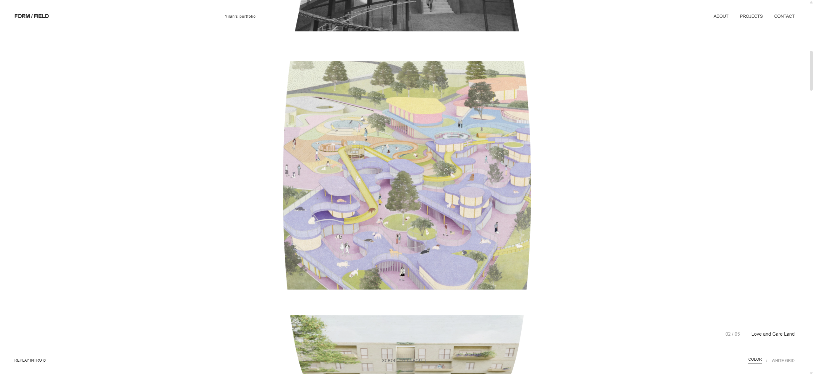
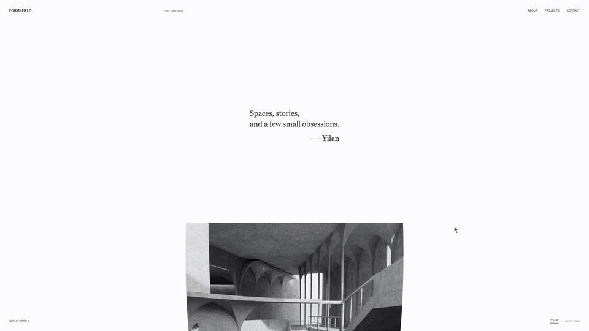
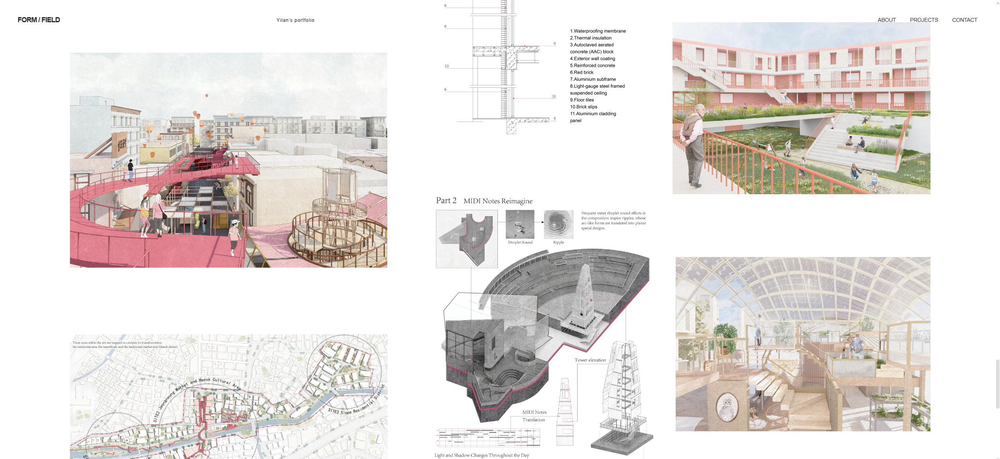
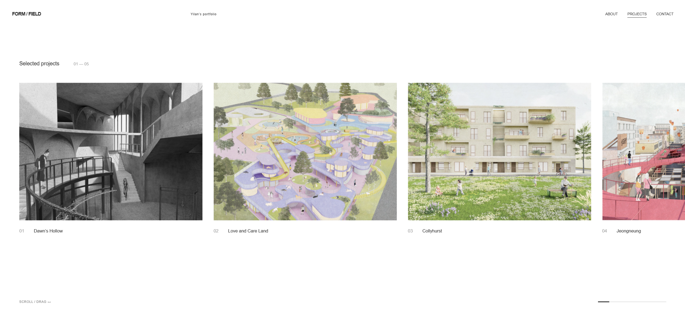
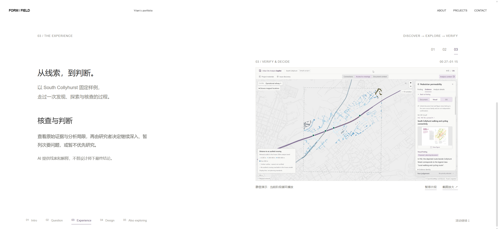
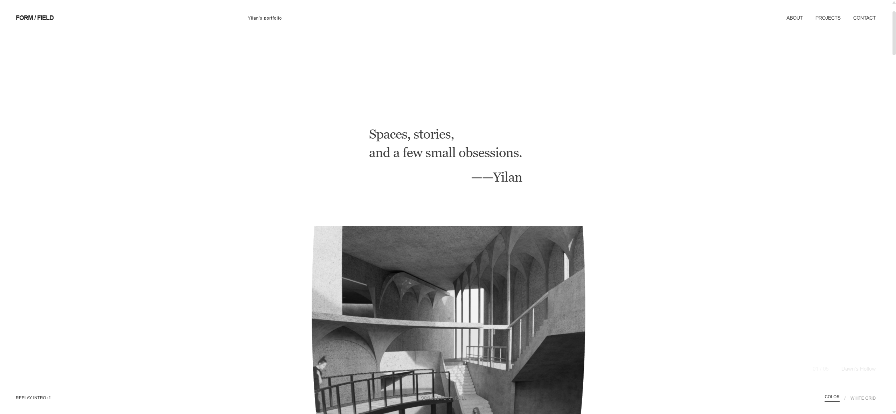

# Interactive Portfolio

**Architecture × AI × Creative Coding**

把建筑作品、AI 实践与个人兴趣，组织成一个可以滚动、展开、翻阅和探索的作品集。

这是我的个人交互式作品集网站，也是一项从视觉构想到真实网页的设计实践：用白色留白与克制排版承接作品，让 Jelly 封面、Stack 转场、横向索引与展板阅读形成不同层次的浏览节奏。网站展示 AI 项目，但网站本身不是独立的 AI 分析产品。

**[Live Website ↗](https://portfolio.orbit8907.com/) · [Full Case Study](PROJECT_CASE_STUDY.md)**

首页交互片段取自既有演示视频前 5 秒，按原片时间顺序循环展示。原演示经过剪辑并含部分加速；这张 GIF 用于说明交互，不是实时性能测试。

## 设计重点

- **从展示到阅读**：首页曲面封面建立视觉印象；横向索引用于选择项目；A3 Viewer 支持逐页阅读、点击放大与局部查看。
- **让图像决定版式**：Gallery 是 14 张真实项目图像组成的自由排版档案，保留原图比例，并支持本地移动、缩放和布局 JSON 导出。
- **连接建筑与数字实践**：PROJECTS 展开 Architecture / AI & Digital 双栏入口；建筑索引末尾与最后一张 Jelly 封面下方提供轻量的数字项目链接。
- **保留一点个人性格**：About 逐段揭示中文介绍，角落的 Puffy 注脚可展开真实照片；CONTACT 通过悬停、聚焦或触屏点击显示邮箱。

## Design-to-Code

从视觉意图到可运行网站，我通过真实素材、布局参考和具体交互反馈逐步推进：先确定构图与浏览路径，再通过预览检查触发时机、图像比例与返回位置，最后将调整落实为代码和可访问的网页。

- **构图可交付**：将 Gallery 的浏览器本地编辑与所有访客可见的正式布局分开，通过 JSON 保存和发布作者选定的构图。
- **转场有上下文**：从 Jelly 选择 Architecture 保留 Stack；从其他页面进入则直接打开索引，避免重复开场。
- **媒介保持连续**：调整 Copilot 展示的首帧、播放起点和图像比例，让静态界面与真实动态预览连贯衔接。

具体过程与提交记录见 [Full Case Study](PROJECT_CASE_STUDY.md)。

## 个人角色与AI协作

我提供作品素材、视觉与交互方向、布局参考以及逐轮修改反馈；Codex 辅助生成、修改、调试代码，并协助构建和部署。我通过预览与反馈推进实现，不将 AI 辅助代码表述为本人逐行手写。

个人独立完成与小组共同成果的具体边界，以及建筑素材内部是否使用 AIGC，仍需作者确认；本草稿不作统一归属声明。可核查的设计迭代与待确认清单见[详细案例](PROJECT_CASE_STUDY.md#7-my-role--reflection)。

## 技术实现

原生 HTML / CSS / JavaScript ES Modules；Three.js / WebGL 曲面与自定义 GLSL；DOM / CSS / Web Animations API 页面交互；静态资源通过 GitHub 与 Vercel 发布。当前网站不是 React 应用，也未使用 GSAP 或 Framer Motion。

本文件夹是独立的作品展示材料，不包含网站源码或运行环境。请通过上方 Live Website 体验交互，通过 Full Case Study 阅读设计与实现过程。

## 首页静态画面

静态配图全部使用作者选择的「首页2」「index」「gallery」「ai demo」「首页」，不恢复此前的助手抽帧。「首页」目前仅作为静态画面展示，不再作为完整视频入口。完整 MP4 暂不在 GitHub 展示或上传。

## In English

An interactive portfolio connecting architecture, AI practice and creative coding. I shaped the visual and interaction direction, supplied project assets and refined the experience through iterative feedback. Codex assisted with implementation, debugging and delivery. The result combines a WebGL cover showcase with editorial image browsing and detailed project reading.

---

文档草稿，待作者确认。代码核对基线：`c6fd71f`；整理日期：2026-11-17。作品、照片与第三方资料的公开使用范围须分别确认；本展示包未新增授权许可。
