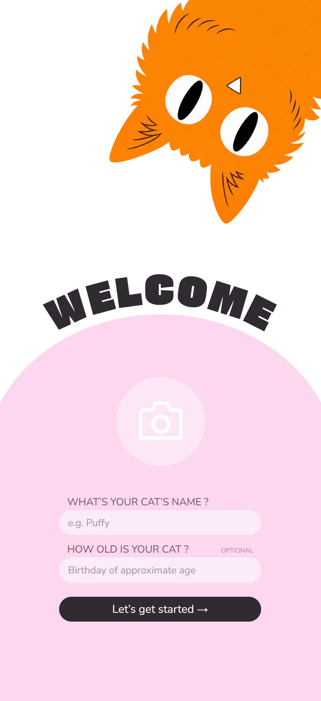
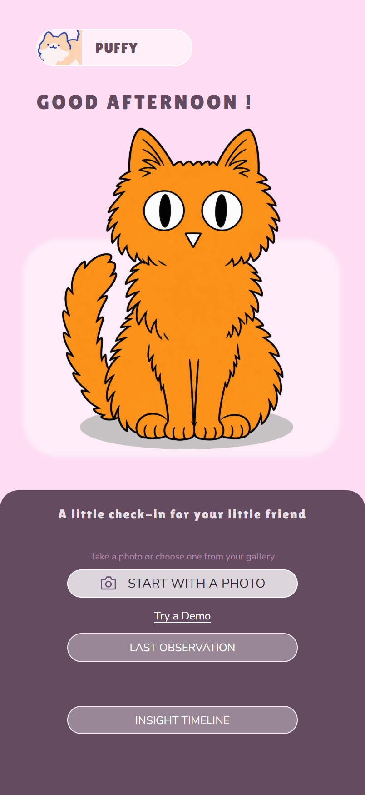
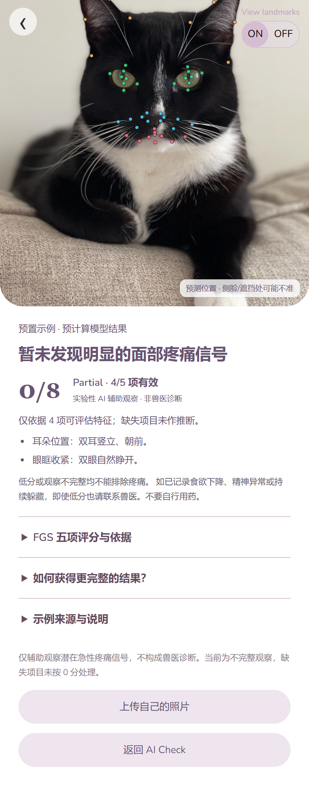
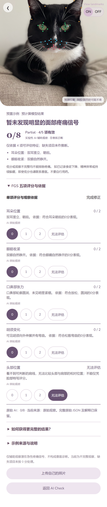

# MewCue｜让 AI 面部观察保留证据与不确定性

**一句话介绍：**MewCue 是一个面向猫主人的移动端 PWA 原型，将照片适用性、FGS 五项面部观察、证据解释和人工修正组织成可交互流程；公开作品版展示已保存的真实 AI 观察及 48 点预测。

**项目状态：**已有可运行公开 Demo；真实 FGS 链路和 Python/LiteRT 关键点推理曾在本地验证。公开版不开放付费上传、不提供实时关键点服务，也没有临床有效性或真实用户成效结论。

[体验 Demo](https://mewcue-puce.vercel.app) · [项目首页](README.md)

## 案例与证据说明

本案例区分个人经历、设计决策与工程验证：产品动机来自我的养猫经历；功能与规则可通过代码核对；测试结论来自对应阶段的存档和报告。个人经历不等于正式用户研究，软件验收也不能证明模型准确率或产品有效性。涉及效果的陈述仅限已有记录支持的范围。

## 1. 产品背景与问题定义

MewCue 源于我的真实养猫经历。在英国留学期间，家里的猫 Puffy 曾患胰腺炎，住院治疗了十天。最初，家人没有意识到她可能正在忍受疼痛，还曾将一些异常表现理解为怕冷。这段经历让我开始关注：当猫咪的不适表现不容易辨认时，普通主人如何获得更清晰、可核对的观察信息？

我希望探索一种适合日常家庭环境的辅助观察工具：通过照片，结合 Feline Grimace Scale（FGS）的五项面部观察指标，将可能与疼痛相关的线索整理为主人能够理解和核对的信息。MewCue 因此被定位为居家辅助观察原型，不承担疾病诊断，也不替代兽医评估。

这一定位贯穿了后续交互设计：先判断照片是否适合观察，对无法辨认的指标保留缺失状态，说明判断依据，并允许主人修正评分、追溯原始 AI 输出。设计重点是帮助主人理解“观察到了什么、哪些还无法判断”，而不只是获得一个分数。

这段个人经历是项目的设计起点，不是正式用户研究。Puffy 的病情未被用作模型训练或产品有效性的证据；本项目也没有证据表明能够提前诊断胰腺炎或避免延误就医。后续实现与测试能支持哪些结论，仍以对应代码、记录及其验证范围为准。

**围绕这一目标，我在原型与模型检查中重点处理以下问题：**

1. 照片未必包含可靠评分所需的信息；脸部特写可能缺少肩线，睡眠、遮挡也可能使观察不适用。
2. 单一总分容易掩盖缺失信息；4 项有效时显示“无法可靠评分”，又会遮蔽已有观察的价值。
3. 结果页同时堆叠完成度、总分和多段总结，用户需要先理解当前观察，再决定是否展开依据或补拍。
4. 模型输出需要允许核对与修正，但人工修正不应覆盖原始 AI 结果。
5. “输出 48 个点”并不证明每个点可靠或可见，公开展示需要与模型实际能力、成本和授权边界一致。

**设计目标：**帮助使用者分辨“看到了什么”“哪些还看不清”“接下来可以做什么”。目前可以评价流程是否实现，尚不能评价它是否改善真实猫主人的判断或就医决策。

## 2. 个人工作范围

这是个人项目。我主导产品定义、交互设计、视觉落地与阶段验收，独立完成 Figma UI，并使用 Lovart 生成插画。Codex 辅助代码实现、测试、调试与部署；FGS 量表和预训练模型来自外部。

| 工作范围           | 我的工作                                                                                      | 工具与能力来源                                             |
| ------------------ | --------------------------------------------------------------------------------------------- | ---------------------------------------------------------- |
| 产品定义与范围控制 | 定义移动优先的居家辅助观察场景；先完成交互，再验证真实分析；控制 Timeline、家庭共享等扩展范围 | 由我提出产品目标、约束与分阶段验收要求                     |
| UI与交互设计       | 独立完成Figma UI；设计Photo Tips、Partial、首屏结论、折叠详情及三帧开屏；核对实现效果         | Figma用于设计交付，Codex辅助前端实现                       |
| 插画素材           | 使用Lovart生成猫咪插画，并将素材应用于页面视觉                                                | 插画为AI生成素材，页面设计由我完成                         |
| AI观察流程         | 定义照片适用性、不确定性、原始评分与人工修正的关系；限制每轮收费测试范围                      | 采用既有FGS标准与第三方推理能力                            |
| 视觉落地           | 检查猫咪裁切、字体弧线等偏差；使用可视化调节方式确认布局并导出JSON                            | Codex辅助构建本地编辑器，配置复用于正式页面                |
| 验收与发布         | 拆分任务、检查样例、审阅结果并决定是否进入下一阶段；明确公开版运行边界                        | Codex辅助代码、测试、脚本和部署操作，GitHub/Vercel承载发布 |

## 3. 功能、信息架构与交互

信息架构由同一 PWA 内的页面状态与交互分支组成：

```text
Opening：三帧预加载 → 500 / 500 / 900ms 硬切
  └─ Welcome：猫名、可选年龄、可选头像 → AI Check
       ├─ Try a Demo → AI Insight（真实存档＋对应48点）
       │    ├─ 一句观察结论＋实际有效分数＋有效项数
       │    ├─ Landmarks ON / OFF
       │    ├─ 折叠：FGS五项评分与依据 → 人工修正 / 恢复
       │    └─ 折叠：补拍建议、案例来源
       ├─ Start with a photo → Photo Tips → 拍照/选图 → 预览
       │    ├─ 公开版：分析关闭，明确说明
       │    └─ 本地受控真实模式：适用性与FGS在一次请求中完成
       │         ├─ 整体不适用：停留反馈弹层 → Retake / Choose Another
       │         └─ 可观察：进入Insight，保留null与对应理由
       ├─ Last Observation：本浏览器最近一次观察
       └─ Timeline：占位提示，未实现
```

Welcome 是基础资料录入，不是登录或认证。目前每次开屏结束都会进入 Welcome，旧资料会回填；当前实现不会永久跳过这一页面。资料和最近一次观察存储在 localStorage，没有云端账户、数据库或跨设备同步。

FGS 五项为耳朵位置、眼眶收紧、口鼻部张力、胡须位置、头部位置。每项保留 0/1/2/null、观察与理由；`null` 表示不能评估，不等于 0。

| 条件           | 展示             | 当前产品规则                         |
| -------------- | ---------------- | ------------------------------------ |
| 5 项有效       | Complete         | 实际总和 / 10                        |
| 3–4 项有效     | Partial          | 实际总和 / 6 或 / 8，列明缺失项      |
| 少于 3 项有效  | Unable to assess | 保留单项，不呈现总体评分             |
| 照片整体不适用 | Unsuitable       | 留在反馈与换图流程，不进入正常分数页 |

这套完整度映射是本产品规则，不是经临床验证的部分自动评分方案。48 点是位置可视化，不用于计算 FGS。

## 4. 关键设计决策

### 4.1 将输入质量纳入交互，而不只在结果后报错

**设计依据：**我希望拍照引导能帮助主人理解输入条件，同时复用一次分析请求，避免为适用性判断重复收费。A/B/D真实测试提供了缺肩线和不适用姿态的具体样例。

**实现：** 上传入口提供清醒安静、近正面、光线及头肩关系提示，并提醒不要强迫摆姿势或叫醒猫咪。整体不适用时展示原因和针对性补拍建议，保留上一次可用结果。

**取舍与未验证项：**增加输入引导及拒绝结果分支；尚无用户实验证明其提高照片合格率或降低放弃率。依据：PHOTO-GUIDANCE.md（原项目记录）。

### 4.2 用 Partial 表达已有价值，保留真实分母

**阶段记录：** 第一轮真实测试中，A 为 4 项有效、0/8，B 为 3 项有效、1/6，却都被旧规则标记为 `unreliable`。我将完整度细分，避免把部分有效观察表现为整次无价值。

**实现：** 3–4 项有效显示 Partial；不外推到 /10，也不猜测缺失指标。针对口鼻判断过度依赖整体脸型的风险，后续 Prompt 强调局部证据和不可评估条件。

**证据限度：**界面与规则通过存档回放验证；没有用这轮回放证明修改 Prompt 后的真实模型准确率提高。依据：FGS 测试（原项目记录）、Partial 更新（原项目记录）。

### 4.3 分离“观察结论”与“观察完整度”

**设计依据：**在体验原型后，我将首屏的信息优先级调整为先说明观察到的信号，再说明观察完整度；“部分观察已完成”退为次级信息。这是我的设计判断，尚无用户研究验证这一信息顺序的效果。

**实现：** 首屏改为谨慎的观察标题、当前有效分数、有效数量、最多两条依据和提醒；Complete/Partial 降为次级信息。五项详情默认折叠，展开后自然纵向滚动。异常标记与已观察到的明显信号不会被 Partial 覆盖。

**取舍：**压缩首屏信息但保留追溯入口。不能将该调整写成“用户理解率提高了某个百分比”，目前没有对照可用性数据。依据：RESULT-UX.md（原项目记录）、展示映射代码（原项目记录）。

### 4.4 将人工修正做成可追溯的数据层

**设计依据：**从真实API接入阶段起，我将保留原始结果与修正来源作为验收要求：人工修改后需要更新当前总分和解释，同时保留AI输出以便核对。

**实现：** `aiScores` 与 `corrections` 分开保存，修正包含来源与时间，当前显示读取有效分数。恢复按钮只清除修正；人工选值不会继续冒用原始 AI 解释作为当前依据。

**边界：**这是可纠错设计，不代表普通用户修改一定更准确，也没有专家审阅闭环。依据：观察数据结构（原项目记录）、Insight（原项目记录）。

### 4.5 将真实关键点能力与公开运行边界分开

**阶段记录：** 本地 LiteRT 测试发现：侧脸、遮挡和睡眠时仍能输出不可靠点位；纯灰无猫图也能产生框和 48 点。随后先完成本地集成，再为求职版选择预计算示例，暂不部署 Python。

**实现：** 公开 A 案例绑定原图、真实 FGS JSON、48 点和来源信息；`demo/upload` 与 `model/mock` 是不同维度。上传不能继承 Demo 的点位；公开结果明确标注预计算，隐藏上传模式的关键点开关。

**取舍：**招聘方能体验已完成的交互和真实输出，但公开站不是实时推理产品。此决策也回应非商业权重、运行环境及收费接口保护的限制；没有将坐标换算为疼痛分数。依据：PUBLIC-DEMO.md（原项目记录）、本机未入库的模型验证报告 `experiments/landmarks/REPORT.md`、Demo 绑定（原项目记录）。

### 4.6 给设计者保留直接调整布局的能力

**设计依据：**实现预览中出现首帧裁切和Welcome弧形文字与设计稿不符的问题。我选择本地可视化调节方式，直接调整位置、大小和弧线关系，最终导出JSON确认布局。

**实现：** `/layout-editor` 可拖动与缩放角色、叠加参考图、调粉色椭圆和文字路径；正式页面复用配置，Vercel 禁用编辑器。字体使用本地 Gasoek One，三帧直接硬切。

**设计意义：**把具体位置反馈转化为可检查、可导出的参数，减少仅靠文字描述裁切位置的歧义。减少了多少轮返工、节省多少时间仍无统计证据。依据：布局调节记录（原项目记录）、开屏记录（原项目记录）。

## 5. AI-native / Vibe Coding 工作流

以下流程由可访问对话、阶段文件与本人补充支持。AI工具分别承担视觉素材生成、产品内推理和开发辅助，产品取舍与验收由本人负责。

| 阶段             | 人负责的判断与输入                                                | AI辅助实现及可检查产物                                                   |
| ---------------- | ----------------------------------------------------------------- | ------------------------------------------------------------------------ |
| UI与视觉素材     | 独立完成Figma UI，使用Lovart生成插画，并提供导出素材与页面约束    | Lovart提供插画生成能力；Codex检查项目并辅助生成React组件与静态交互       |
| 从Mock到真实链路 | 明确Schema、FGS边界、适用性与收费次数；先要求检查网络再做单图测试 | Responses服务端接口、校验/预处理、错误处理、一次请求记录                 |
| 小规模模型检查   | 批准 A/B/D 每类一次；要求记录可见依据、null和token                | 保存3组真实JSON与用量，冻结Prompt/阈值/预处理后比较                      |
| 根据结果迭代     | 提出Partial、首屏结论、折叠详情和人工修正的验收标准               | 先改最小范围，再用原JSON免费回归；不靠重复收费制造成功结果               |
| 独立验证关键点   | 指定已有预训练模型，先看真实叠加，再批准集成                      | Python/LiteRT两阶段推理、EXIF/letterbox/crop坐标还原、叠加图及负样本记录 |
| 设计调参与发布   | 直接调整布局并确认JSON；决定公开版边界，完成账号授权              | 本地编辑器、版本化配置、GitHub/Vercel发布及匿名验收                      |

其中 AI 承担三类角色：**Lovart的插画生成**、**产品内的视觉推理能力**、**Codex的代码与测试辅助**。Figma设计由本人完成；生成和实现结果需要本人选择、核对与验收。可展示的能力是把需求转成状态、数据契约和验收条件，发现失败后缩小范围并修正表达；尚无证据量化 AI 带来的开发提速或质量提升。

## 6. 技术与真实实现边界

| 层次       | 当前实现                                                             | 选择依据或边界                                                     |
| ---------- | -------------------------------------------------------------------- | ------------------------------------------------------------------ |
| 前端/PWA   | Next.js 16.4.6、React 19.2、TypeScript、CSS、Manifest/Service Worker | 历史需求优先该栈与Vercel兼容；不反推为经过多套框架实验后的最优方案 |
| 动效与几何 | 解码预加载、定时硬切、SVG textPath与关键点叠加                       | 对应三帧效果与现有图像裁切；不是AI生成中间帧                       |
| FGS后端    | Responses + Structured Outputs、Zod、Sharp、后端重算                 | Schema约束输出格式；后端校验规则；均不能保证视觉语义正确           |
| 模型配置   | `OPENAI_MODEL` 服务端变量，当前默认/历史记录为 `gpt-6.1-terra`       | 这是项目记录与配置值，本轮没有验证模型当前可用性、权限或价格       |
| 本地关键点 | Python/LiteRT、224定位器＋384预测器、48对坐标                        | 第三方预训练权重，无重新训练；完整实验目录留本机且Git忽略          |
| 数据与安全 | localStorage、原始输出与修正分层、Demo绑定；Key仅服务端              | 无账户隔离/云端同步；公开上传关闭，不能宣称零隐私风险              |
| 发布与回归 | GitHub Actions、Vercel、Playwright                                   | CI检查与发布记录存在；Chrome移动视口不等于iOS实机兼容性认证        |

公开版只启用预置 Demo。受控本地真实 FGS 和实时关键点是另外的运行模式，不应把三者混称为线上完整服务。代码中还有受控付费接口的口令/共享计数保护，但生产未启用；Redis相关替身测试不等于线上配额服务已验收。

## 7. 验证过什么，尚未验证什么

### 真实 FGS 的有限观察

**2026-11-11第一轮真实测试：A/B/D各一次，合计3次请求。**

| 样例            | 原始分数：耳/眼/口鼻/胡须/头 | 结果     | 能支持的发现                                       |
| --------------- | ---------------------------- | -------- | -------------------------------------------------- |
| A 近正脸        | 0/0/0/0/null                 | 4项，0/8 | 模型保留了无法可靠判断的头肩关系                   |
| B A图的脸部裁切 | 0/0/null/1/null              | 3项，1/6 | 缺肩线时未强行给头部分；裁切后胡须等观察也发生变化 |
| D 闭眼卷卧      | 全null                       | 不适用   | 没有把闭眼直接当疼痛评分；引导等待自然清醒         |

A/B不是两个独立猫样本，没有专家疼痛标签。该轮无完整5项样例，也没有完成C/E/F或重复稳定性测试。记录合计10034 tokens，实际美元账单金额未知；不能将“HTTP200/Schema通过”写成识别准确或临床有效。

### 关键点与软件回归

- **阶段记录：** 本地报告记录12个照片/衍生用例及1个无猫负样本，存在样例相关性；7项几何/EXIF等检查通过。没有专家关键点真值，无法给出定位准确率。
- **阶段记录：** 发布前完整免费回归记录为60通过、13跳过，其中8项收费、5项本地Python检查跳过；示例专项又有5项通过。**这些数字属于对应阶段，不能相加成独立用户样本或当前全部测试数量。**
- **阶段记录：** 2026-11-13记录了GitHub/Vercel构建及正式域名的匿名流程检查，覆盖手机宽度、坐标映射、人工修正及收费关闭。此处引用历史验收记录，不代表本次文档整理重新执行了测试。
- **证据边界：**现有材料未包含正式访谈、可用性研究或兽医咨询记录，也未提供转化率、留存、满意度、商业收益、专业一致性或临床验证数据。本人验收和自动化回归仅作为工程与交互实现的证据。

## 8. Demo与界面展示

**体验顺序：**Opening → Welcome填入示例猫名 → AI Check点击 **Try a Demo** → AI Insight → ON/OFF → 展开五项依据 → 修改一项评分 → 恢复原始评分。

2026-11-17已核实在线Demo可匿名访问，预置案例照片与存档哈希一致，显示48点，付费上传与本地关键点推理均关闭。本次访问使用验收电脑已有网络代理；应用不依赖该代理，目标地区直连可达性仍需自行确认。本次没有发起付费分析。

| Welcome：真实运行界面                                                                         | AI Check：真实运行界面                                                                    | AI Insight：真实运行界面                                                                     |
| --------------------------------------------------------------------------------------------- | ----------------------------------------------------------------------------------------- | -------------------------------------------------------------------------------------------- |
|  |  |  |

以上图片于2026-11-17从现有在线产品的无登录浏览器实际截取：402×874 CSS像素、2倍设备像素；等待字体与图片加载后保存原始PNG，没有重新生成界面或修改截图。Welcome为实际运行页，不是Figma导出图。首页使用示例名称Puffy；结果页的黑白猫为公开许可案例A，不是Puffy。 照片与模型出处见[素材来源](ASSET_CREDITS.md)。

<details>
<summary>展开查看五项评分与人工修正入口</summary>



截图仅打开修正入口，未改动原始AI评分；头部保留无法评估。

</details>

**展示建议（尚未执行）：**

1. 60–90秒演示公开核心流程，明确说“真实模型预计算示例”，避免给人上传即实时识别的印象。
2. 用一页决策对照说明“4/5项被标为unreliable → Partial真实分母 → 结论与完整度分层”。这是设计迭代，不虚构用户效果。
3. 展示A/B/D原始观察对照与人工修正数据，说明如何处理缺失和矛盾，而不是只展示理想结果。
4. 需要讲述本地实时推理时，单独标明运行环境；公开视频避免私人猫照、密钥、桌面账号和本地路径。

## 9. 当前局限与下一步验证问题

- 一张静态照片无法证明猫持续清醒安静，头肩、毛发、角度、品种等影响观察；低分不能确认无痛。
- 关键点模型缺猫脸存在/单点可见性置信度，遮挡仍会输出预测；没有通用可靠拒识。
- 公开版只有1个预置案例，不能展示完整的正常/异常/不适用真实案例覆盖，更不能推导泛化能力。
- 现有材料未包含真实用户研究或兽医验证证据；Partial提醒属于产品规则，未经临床验证，尚无重复评分稳定性结果。
- localStorage仅保存本机资料/最近观察，非用户账户；无Timeline、家庭共享、跨端数据库或完整删除后台。
- PWA安装与手机相机/键盘等仍需iOS实机验证；当前Manifest与部分元数据还使用“Cat Wellness”，与作品名MewCue未完全统一。
- 权重CC BY-NC 4.0，未公开部署或分发；公开开关是发布者确认，不是商业权重许可。预测输出的公开使用条件未获单独授权说明，商业化前需核对，不能在简历中宣称已获商业授权。

后续应先回答“普通猫主人是否看懂不完整观察及下一步建议”，再扩展功能。可设计任务式可用性测试，并邀请合适的专业人员审查表述；**这是下一步建议，不是已经完成的工作。**

## 10. 项目总结

MewCue 将一次个人经历带来的关注，转化为可以运行、检查与修正的产品原型。我的核心工作是把居家辅助观察的定位落实到具体交互：明确输入条件、保留缺失信息、分离结论与完整度，并让人工修正可追溯。

这一过程也让我将模型能力、交互实现和产品有效性作为三个不同层面来判断。真实API与关键点推理可以跑通，仍需要明确其失败情形；工程回归可以验证页面与数据逻辑，仍不能代替用户研究或临床验证。下一步的重点是验证主人能否理解观察边界与后续建议，再决定功能扩展。

## English overview

MewCue is a personal, mobile-first PWA prototype for photo-based feline facial observation. I designed the UI in Figma and used Lovart to generate the illustrations, with Codex assisting implementation, testing and deployment. It combines photo guidance, suitability checks, five Feline Grimace Scale action units, evidence explanations and traceable human corrections. The public portfolio demo uses archived real AI responses and matching, precomputed 48-point landmark predictions; paid uploads and live landmark inference are disabled. It is an experimental observation aid, not a veterinary diagnostic tool. The motivation comes from my experience with my cat Puffy; that experience is not user research or evidence of product effectiveness.

## 验证材料说明

本案例的功能描述依据现有实现，历史结果依据2026-11-11的FGS A/B/D测试、2026-11-12的本地关键点验证及2026-11-13的发布验收记录。2026-11-17另核实了在线Demo与截图来源，未重新调用模型。源代码、原始请求JSON及工程报告留在开发项目，不随展示包分发；本包不以省略原始文件的方式新增任何准确率或产品效果结论。
