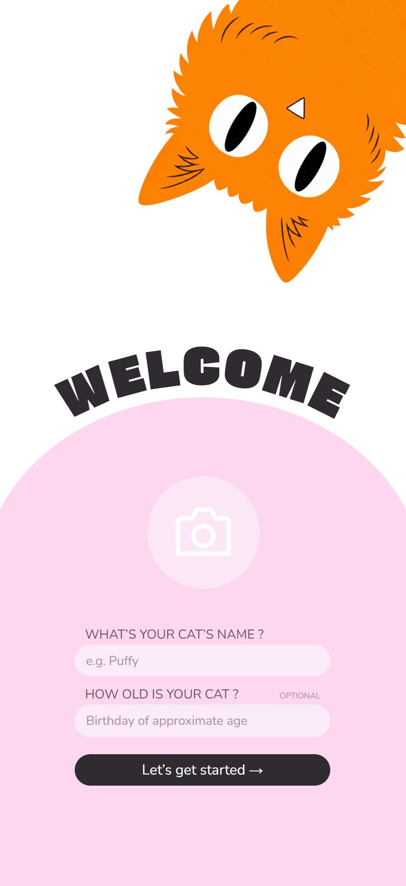
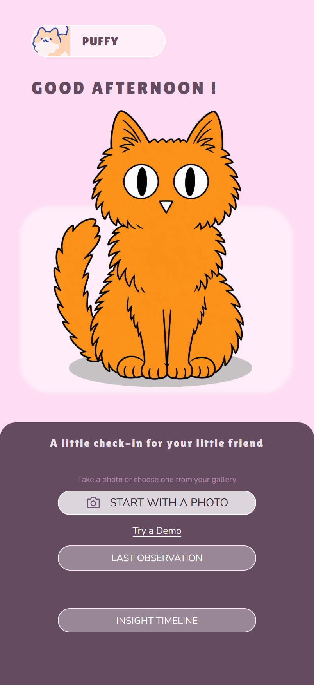
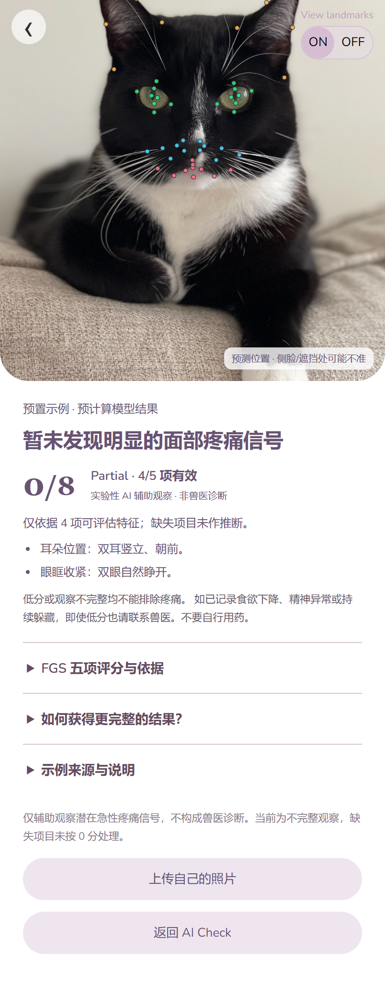

# MewCue｜猫咪面部观察 PWA

面向猫主人的移动端居家辅助观察原型，通过照片、FGS五项面部观察、证据解释和可追溯人工修正，帮助使用者核对AI观察到的线索与缺失信息。

**[体验 Demo](https://mewcue-puce.vercel.app)** · **[完整项目案例](PROJECT_CASE_STUDY.md)**

公开版使用**真实模型预计算示例**：已保存的真实 FGS 响应与同一张照片的 48 点预测配套展示。付费上传和实时 Python 推理均关闭，不是上传即实时诊断。

## 产品起点

MewCue 源于我的养猫经历。在英国留学期间，家里的猫 Puffy 曾因胰腺炎住院十天；最初，家人未能意识到她可能正在忍受疼痛，还将部分异常表现理解为怕冷。这让我开始探索：如何把猫咪面部可能存在的疼痛线索，转化为普通主人更容易理解和核对的信息？

我以照片和 Feline Grimace Scale（FGS）为基础，设计了一个居家辅助观察 PWA 原型，重视照片适用性、不确定性、观察依据和可追溯人工修正。这是个人经历驱动的设计探索，不是正式用户研究，也不代表产品能够诊断疾病或避免延误就医。Puffy的具体病情不作为模型训练或产品有效性的证据。

## 体验路径

1. 三帧开屏自动切换后，在 Welcome 填写示例猫名；年龄和头像可选，无需账户。
2. AI Check 点击 **Try a Demo**，进入 A 案例。
3. 查看观察结论、`Partial · 4/5 项有效` 与 `0/8`。头部无法评估，未按 0 补齐。
4. 切换 **View Landmarks ON / OFF**，查看真实预计算的 48 点。
5. 展开「FGS 五项评分与依据」，修改单项评分，再恢复原始 AI 结果。

2026-11-17已核实在线Demo可匿名访问，预置案例照片与存档哈希一致，显示48点，付费上传与本地关键点推理均关闭。本次访问使用验收电脑已有网络代理；应用不依赖该代理，目标地区直连可达性仍需自行确认。本次没有发起付费分析。

## 界面预览

| Welcome：真实运行界面                                                                         | AI Check：真实运行界面                                                                    | AI Insight：真实运行界面                                                                     |
| --------------------------------------------------------------------------------------------- | ----------------------------------------------------------------------------------------- | -------------------------------------------------------------------------------------------- |
|  |  |  |

以上图片于2026-11-17从现有在线产品的无登录浏览器实际截取：402×874 CSS像素、2倍设备像素；等待字体与图片加载后保存原始PNG，没有重新生成界面或修改截图。Welcome为实际运行页，不是Figma导出图。首页使用示例名称Puffy；结果页的黑白猫为公开许可案例A，不是Puffy。 照片与模型出处见[素材来源](ASSET_CREDITS.md)。

## 这个案例展示的设计工作

- **把输入质量纳入交互：**Photo Tips 提醒清醒、近正面、光线与头肩关系；整体不适用时提供原因和补拍入口。
- **表达不确定性：**观察结论与Complete/Partial分层，保留真实有效分母，低分不解释为确认无痛。
- **支持核对与修正：**首屏保留重点依据，详情折叠；人工修正更新当前结果，原始分数、解释与JSON不覆盖。
- **控制公开展示边界：**先验证本地关键点模型，再提供绑定原图的预计算示例；Demo与上传数据隔离。
- **通过AI辅助交付：**将需求拆成约束、数据契约与验收条件；本地可视化编辑器支持设计者直接调布局并导出配置。

**个人项目与贡献：**我主导产品定义、交互设计与阶段验收，并独立完成 Figma UI 设计；插画使用 Lovart 生成。Codex 辅助代码实现、测试和部署。FGS量表、基础模型和猫脸权重来自外部，不主张自行发明或训练。设计依据与证据分类见[完整案例](PROJECT_CASE_STUDY.md)。

## 已实现与当前边界

| 能力                                      | 公开作品版         | 本地实现/历史记录                                   |
| ----------------------------------------- | ------------------ | --------------------------------------------------- |
| Opening → Welcome → AI Check → AI Insight | 可交互             | 三帧预加载，500/500/900ms硬切；资料保存与回填       |
| Try a Demo、48点开关、人工修正            | 已开放             | A原图＋真实FGS存档＋对应48点                        |
| 拍照/选图、预览、Photo Tips               | 入口保留，分析禁用 | 可用Mock验证；受控真实模式支持Responses             |
| 适用性、FGS五项及补拍反馈                 | Demo不新增分析     | 本地真实链路和A/B/D历史JSON回放有记录               |
| 实时48点推理                              | 不提供             | Python/LiteRT曾本地验证和集成，实验环境不随仓库分发 |
| Last Observation                          | 本浏览器最近记录   | localStorage，无账户、数据库或跨设备同步            |
| Timeline / 家庭共享                       | 未实现             | Timeline仅占位，不列为产品能力                      |

Welcome不是登录页。目前每次开屏仍进入Welcome并回填资料，未实现“完成一次后永远跳过”。

## 技术与展示包

原产品使用Next.js、React、TypeScript、SVG、Zod与Sharp，真实FGS链路采用服务端Responses及Structured Outputs；本地关键点使用第三方预训练Python/LiteRT模型。展示包不包含上述源码、依赖或模型，仅包含文档与真实产品截图。

```text
README.md                 项目概览与体验入口
PROJECT_CASE_STUDY.md     产品背景、个人工作范围、设计决策与验证边界
ASSET_CREDITS.md          截图、照片与模型来源说明
docs/images/             四张真实产品截图
```

解压后使用Markdown阅读器打开README.md，图片使用相对路径随文档保留；也可将这些展示材料作为独立GitHub作品目录。在线体验请点击Demo链接，离线阅读无需安装依赖或配置密钥。

## 验证与局限

2026-11-13归档记录：发布前免费回归60项通过、13项跳过，另有示例专项和匿名生产流程检查。这是对应阶段的软件验收，**不是60位用户、模型准确率或本轮新测试**。第一轮真实FGS仅A/B/D各一次，A/B来自同一张原图；未完成重复稳定性或临床验证。

FGS仅辅助观察潜在急性疼痛线索，低分不能排除疼痛。没有真实用户成效、专家一致性或疾病诊断结论。关键点缺可靠的猫脸存在/可见性置信度，遮挡预测不能当作真实可见特征。

## 素材来源

截图中的照片、插画与关键点模型来源见[ASSET_CREDITS.md](ASSET_CREDITS.md)。本包不包含私人猫照、模型权重或账户资料。Puffy的经历仅按作者授权作为产品动机叙述。

## English

MewCue is a personal, mobile-first PWA prototype for photo-based feline facial observation. I designed the UI in Figma and used Lovart to generate the illustrations, with Codex assisting implementation, testing and deployment. The prototype explores photo guidance, explicit uncertainty, evidence explanations and traceable human corrections. The public demo presents archived real AI responses with matching, precomputed 48-point facial landmarks; paid uploads and live landmark inference are disabled. It is an experimental observation aid, not a veterinary diagnostic tool.

完整设计决策、个人工作范围与验证边界见 [PROJECT_CASE_STUDY.md](PROJECT_CASE_STUDY.md)。
