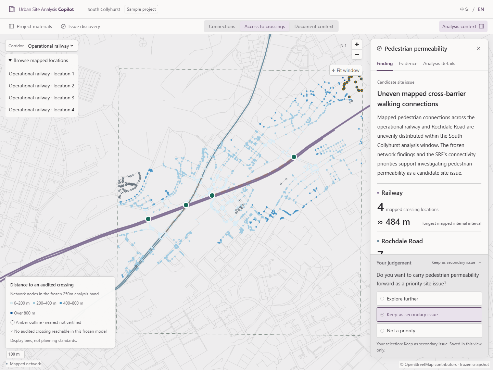
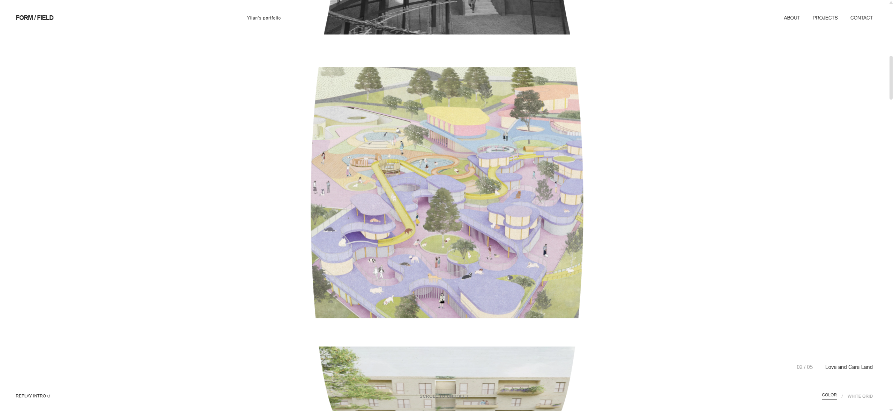
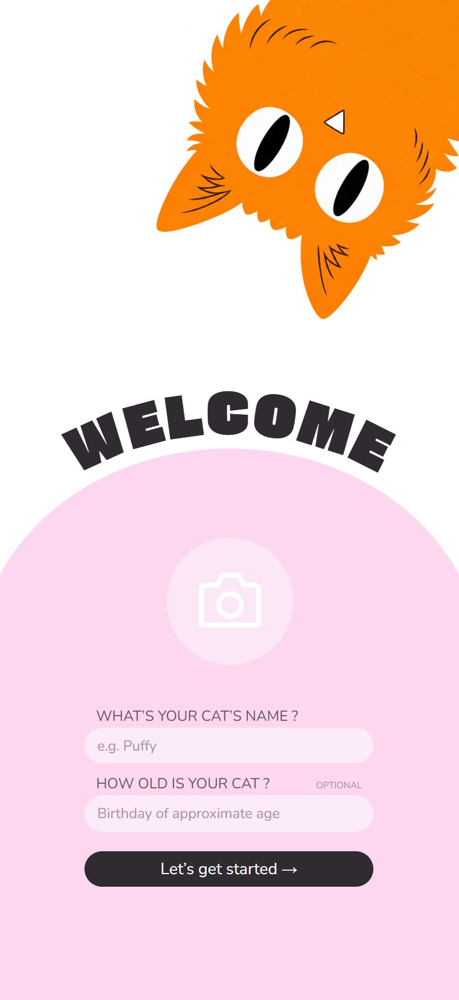
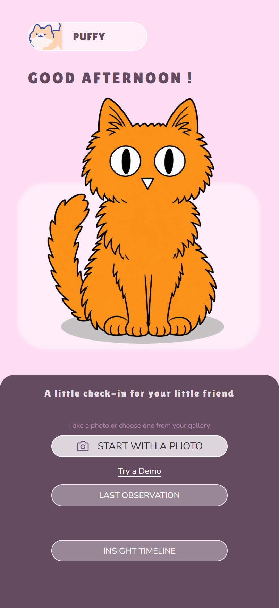
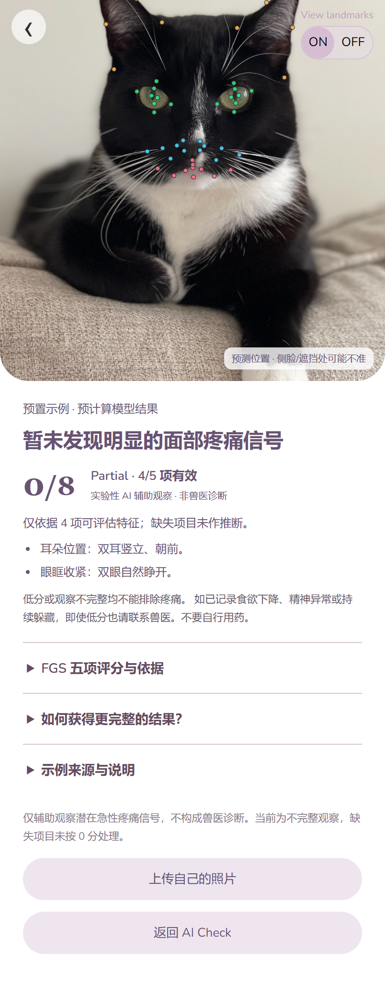

SELECTED WORK · AI PRODUCT DESIGN

# 从复杂信息，到可理解的产品体验

面向小红书 AI 产品设计师校招的作品集。三个项目，呈现我在 **AI 信息组织、交互与视觉设计、Design-to-Code** 中的设计判断与实现实践。

**[01 城市场地分析](#01--urban-site-analysis)** · **[02 交互式作品集](#02--interactive-portfolio)** · **[03 MewCue](#03--mewcue)**

---

## 01 · Urban Site Analysis

### 让 AI 的发现有据可查，让设计判断回到人

面向城市设计前期研究的 AI 辅助分析工作台，以 South Collyhurst 为完整示例，将规划资料、证据线索与空间调查组织到持续地图中。

**设计看点**　复杂信息架构 · 证据追溯 · 渐进披露 · 人机判断分工

我主导产品定义、AI 工作流、信息架构与交互设计，借助 AI 编程助手推进实验与原型。公开 Demo 展示已审核的冻结结果，不执行任意上传的实时分析。主视觉中的优先级是历史验收时人工选择的状态，系统默认不选。

**[Live Demo ↗](https://yilan-demo.orbit8907.com/)**　/　**[Case Study →](01-urban-site-analysis/PROJECT_CASE_STUDY.md)**　/　[项目概览](01-urban-site-analysis/README.md)

---

## 02 · Interactive Portfolio

### 用构图与动效，建立作品的浏览节奏

连接建筑、AI 实践与 Creative Coding 的个人交互式作品集。Jelly 曲面封面、Stack 转场、横向索引与展板阅读，让视觉印象自然延伸到作品细节。

**设计看点**　视觉叙事 · 动效与空间连续性 · 图像构图 · 浏览与阅读路径

我提供作品素材、视觉与交互方向，并通过逐轮预览反馈推进实现；Codex 辅助代码、调试与交付。各建筑作品的个人／小组贡献及待确认事项保留在完整案例中。

**[Live Demo ↗](https://portfolio.orbit8907.com/)**　/　**[Case Study →](02-interactive-portfolio/PROJECT_CASE_STUDY.md)**　/　[项目概览与交互 GIF](02-interactive-portfolio/README.md)

---

## 03 · MewCue

### 把 AI 观察变成可以理解、核对与修正的线索

  
  
  

面向猫主人的移动端居家辅助观察 PWA 原型，将照片适用性、FGS 五项面部观察、依据解释与可追溯人工修正串成完整体验。

**设计看点**　移动端 UI · 输入引导 · 不确定性表达 · 人工核对与修正

我主导产品定义、交互与验收，独立完成 Figma UI；插画由 Lovart 生成，Codex 辅助实现。公开版使用真实模型预计算示例，付费上传与实时推理关闭。它是辅助观察原型，不是兽医诊断工具。

**[Live Demo ↗](https://mewcue-puce.vercel.app)**　/　**[Case Study →](03-mewcue/PROJECT_CASE_STUDY.md)**　/　[项目概览](03-mewcue/README.md)

---

本仓库仅包含展示文档与作者选定的真实界面截图／交互 GIF。三个项目的完整 Markdown 与图片按导出原样保留；贡献、历史验证与能力边界详见各自案例。素材权利仍归原作者或权利人，来源与许可见项目说明及 <a href="03-mewcue/ASSET_CREDITS.md">MewCue 素材来源</a>。
